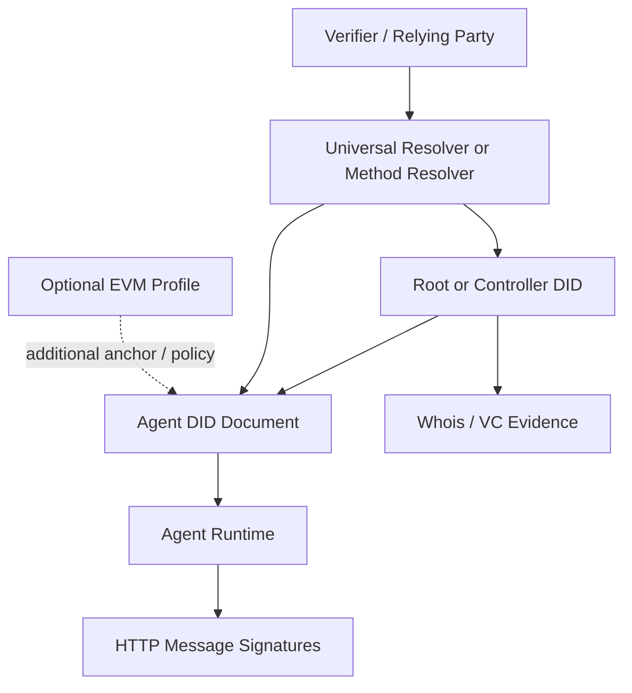

# RFC-001: Agent-DID (Unified Specification)

## Document Status

- **Status:** Release candidate (normative text for the `1.0.0` release contract)
- **Version:** 1.0-rc.5
- **Date:** 2026-11-15
- **Scope:** This RFC is the canonical core specification for Agent-DID as an application pattern on top of `did:webvh`, including the data model, composition semantics, runtime authentication profile, verification algorithms, and the test vectors implementations are checked against. It defines no programming interface: the API of the reference SDKs is described in the non-normative [SDK API Guide](SDK-API-Guide.md).
- **Feedback:** Use the RFC feedback issue template or GitHub Discussions for errata, clarifications, and post-`1.0` proposals. Report vulnerabilities privately through [SECURITY.md](../SECURITY.md).

This revision (1.0-rc.5) supersedes `0.3-pivot-pattern-on-webvh`. It pins the external specifications Agent-DID builds on (§2.1), defines lifecycle authorization (§6.6), and requires that `did:webvh` logs be verifiable by any conforming resolver (§6.1). It is the text the `1.0.0` release will be held to; changes after `1.0.0` follow §11.2. The status does **not** imply W3C, DIF, IETF, or any other external standards-body approval of Agent-DID.

The key words "MUST", "MUST NOT", "REQUIRED", "SHOULD", "SHOULD NOT", "RECOMMENDED" and "MAY" are to be interpreted as described in BCP 14 ([RFC 2119] and [RFC 8174]) when, and only when, they appear in all capitals.

---

## 1. Summary

Agent-DID defines an application pattern on top of W3C DID documents for autonomous AI agents, with `did:webvh` as the recommended default DID method. Its goal is to allow any actor (human, organization, API, or agent) to reliably verify:

1. Who controls the agent.
2. What "brain" it runs (model/base prompt) without exposing sensitive IP.
3. What capabilities or certifications it declares.
4. Whether its identity is active, evolved, or revoked.
5. Whether runtime requests were signed by a key authorized for that agent identity.

The standard extends W3C DIDs/VCs with AI-specific metadata, defines an A2A identity composition contract that binds an agent to a human or organizational controller, and specifies a runtime authentication profile based on HTTP Message Signatures plus anti-replay controls. `did:webvh` is the normative reference method because it provides web-native discoverability and verifiable history; other DID methods MAY be supported as compatibility profiles when they preserve the same composition and verification semantics. EVM anchoring remains available as an optional deployment profile for environments that need additional on-chain immutability.

Agent-DID's conformance scope is deliberately limited to identity, controller/delegation semantics, and runtime signature authorization. A conforming implementation proves who had standing to make a call and whether the signing key was authorized for that action; it does **not** by itself prove that the agent's reasoning was correct or capture the full decision state that led to a call. Those concerns belong to a separate decision-provenance layer, such as signed execution receipts or trace attestations.

---

## 2. Relationship with Existing Standards

- **W3C DID / DID Document:** Foundation for decentralized identity.
- **`did:webvh`:** Recommended default method for agent identifiers, controller chains, and verifiable DID history.
- **W3C Verifiable Credentials (VC):** Support for compliance certifications.
- **`/whois` + organizational evidence (recommended pattern):** Publishes legal-entity and governance evidence that an agent verifier can recurse to.
- **HTTP Message Signatures / Web Bot Auth (emerging):** HTTP request signing for A2A/API authentication.
- **ERC-4337 / Account Abstraction (optional):** Additional deployment profile for autonomous account and economic operations.

Agent-DID does not replace these standards and does not define a new DID method. It composes them for the specific case of autonomous agents by standardizing AI-specific metadata, controller relationships, verification behavior, and runtime signing expectations.

### 2.1 Normative References

Where this RFC says an item is defined "by" one of these documents, that document governs. If this RFC and a reference disagree, the reference wins and the disagreement is an erratum of this RFC.

| Reference | Used for | Version |
| :--- | :--- | :--- |
| [did:webvh] | DID method, `did.jsonl` log format, SCID, `entryHash` chain, `updateKeys`, deactivation, witnesses (`witness` parameter, `did-witness.json`) | **v1.0** (`method` parameter `did:webvh:1.0`) |
| [DID-CORE] | DID document data model and verification relationships | W3C Recommendation, DID Core v1.0 |
| [RFC 9421] | HTTP Message Signatures (signature base, `Signature-Input`, `Signature`) | RFC 9421 |
| [RFC 8941] | Structured Field Values, as used by `Signature-Input`, `Signature` and `Agent-DID` | RFC 8941 |
| [RFC 9530] | `Content-Digest` header (`sha-256`) | RFC 9530 |
| [RFC 8785] | JSON Canonicalization Scheme (JCS) for hashing | RFC 8785 |
| [RFC 8032] | Ed25519 signatures | RFC 8032 |
| [RFC 2104] | HMAC, for salted commitments (§4.3) | RFC 2104 |
| [RFC 3161] | Timestamp tokens as trusted time evidence (§6.2.2) | RFC 3161 |
| [VC-DATA-MODEL-2.0] | Data model of the `AgentMetadataCredential` (§4.4) | W3C Recommendation, Verifiable Credentials Data Model v2.0 |
| [VC-DI-EDDSA] | `eddsa-jcs-2022` proofs of the `AgentMetadataCredential` (§4.4), with the common algorithms of VC Data Integrity | W3C Recommendation, Data Integrity EdDSA Cryptosuites v1.0; test vectors at the commit pinned in `fixtures/vc-di-eddsa-test-vectors.json` |
| [RFC 7515], [RFC 7519] | JWS and JWT of the OAuth client assertion (§6.8) | RFC 7515, RFC 7519 |
| [RFC 8037] | `EdDSA` JWS algorithm with Ed25519 (§6.8) | RFC 8037 |
| [RFC 9864] | `Ed25519` fully-specified JWS algorithm (§6.8) | RFC 9864 |
| [RFC 2119], [RFC 8174] | Requirement keywords | BCP 14 |

Informative: the IETF *web-bot-auth* drafts (HTTP signing for automated clients). Agent-DID separates itself from them with the `tag` parameter (§6.5). DIF *Linked Verifiable Presentations* (the `LinkedVerifiablePresentation` service type of §4.4). W3C CCG *Authorization Capabilities* (ZCAP) v0.4, the data model of §6.7. RFC 7523 and *draft-ietf-oauth-rfc7523bis* (JWT client authentication), *draft-ietf-oauth-client-id-metadata-document* and RFC 8414 (§6.8). The MCP authorization specification (revision 2026-07-28) and its OAuth Client Credentials extension, which use them.

**Evidence, not assertion.** Which of these references the reference SDKs are shown to satisfy, and by what external evidence, is recorded in [External-Conformance-Matrix.md](External-Conformance-Matrix.md). An implementation MUST NOT claim conformance with a referenced specification on the strength of this RFC alone.

---

## 3. Design Principles

1. **Persistent identity, mutable state:** The DID remains stable; the document can evolve.
2. **Method-aligned default:** `did:webvh` is the default and recommended DID method for normative examples and conformance guidance.
3. **Strong cryptography by default:** Ed25519 recommended for frequent signing.
4. **Composition over method invention:** Agent-DID adds application-layer semantics on top of existing DID methods rather than defining a new method.
5. **Deployment-profile flexibility:** Web-native deployment is the default; optional profiles such as EVM MAY add stronger anchoring where justified.
6. **Interoperability:** JSON-LD schema, method-aware resolution, and deterministic verification behavior across implementations.

---

## 4. Agent-DID Document Structure

### 4.1 Base JSON-LD Schema

```json
{
  "@context": ["https://www.w3.org/ns/did/v1", "https://agent-did.org/v1"],
  "id": "did:webvh:example.com:agents:supportbot-x",
  "controller": "did:webvh:example.com:organizations:acme-support",
  "created": "2026-02-22T14:00:00Z",
  "updated": "2026-02-22T14:00:00Z",
  "agentMetadata": {
    "name": "SupportBot-X",
    "description": "Level 1 technical support agent",
    "version": "1.0.0",
    "coreModelHash": "hash://sha256/... or ipfs://...",
    "systemPromptHash": "hash://sha256/... or ipfs://...",
    "capabilities": ["read:kb", "write:ticket"],
    "memberOf": "did:fleet:0xCorporateSupportFleet"
  },
  "complianceCertifications": [
    {
      "type": "VerifiableCredential",
      "issuer": "did:webvh:trust.example:auditors:trustcorp",
      "credentialSubject": "did:webvh:example.com:agents:supportbot-x",
      "proofHash": "ipfs://Qm..."
    }
  ],
  "verificationMethod": [
    {
      "id": "did:webvh:example.com:agents:supportbot-x#key-1",
      "type": "Multikey",
      "controller": "did:webvh:example.com:organizations:acme-support",
      "publicKeyMultibase": "z6Mk..."
    }
  ],
  "assertionMethod": ["did:webvh:example.com:agents:supportbot-x#key-1"],
  "authentication": ["did:webvh:example.com:agents:supportbot-x#key-1"]
}
```

#### 4.1.1 The `https://agent-did.org/v1` context

The context is defined by [`contexts/v1.jsonld`](../contexts/v1.jsonld) (decision: [ADR-003](ADR-003-JSON-LD-Context-and-agentMetadata.md)). It defines the Agent-DID terms (`agentMetadata` and its members, `complianceCertifications`, `blockchainAccountId`, `deactivated`) and the terms and types that the W3C DID v1 context lacks and that this RFC uses (`created`, `updated`, `publicKeyMultibase`, `Ed25519VerificationKey2020`, `Multikey`, `EcdsaSecp256k1RecoveryMethod2020`).

- A published context version is immutable. Its SHA-256 is pinned in `contexts/v1.jsonld.sha256`; a change to any term requires a new version at a new URL.
- Verifiers that process JSON-LD SHOULD use the pinned copy instead of fetching the URL. Agent-DID verification itself does not require JSON-LD processing: documents are hashed as JSON with JCS (§6.1), so an implementation conforms without a JSON-LD processor.
- Until `https://agent-did.org/v1` is served with the pinned bytes, the repository copy is the only normative source.
- `agentMetadata` is a property of the DID document. Representing it as a controller-issued Verifiable Credential is not part of 1.0.

The published context is immutable, and it does not define `revoked` (§4.2). A document in which a verification method carries `revoked` MUST end its `@context` with this inline term, and a document without a revoked key MUST NOT carry it:

```json
{ "revoked": { "@id": "https://w3id.org/security#revoked", "@type": "http://www.w3.org/2001/XMLSchema#dateTime" } }
```

It maps `revoked` to the IRI that W3C Controlled Identifiers v1.0 and the Multikey context use. The Multikey context itself cannot be added: it scopes `revoked` inside its protected `Multikey` term, which conflicts with the `Multikey` term of `https://agent-did.org/v1`.

### 4.2 Normative Field Definitions

| Field | Requirement | Description |
| :--- | :--- | :--- |
| `id` | **REQUIRED** | Unique agent DID. `did:webvh:...` is the recommended/default identifier form; other DID methods MAY be used if they preserve the composition and verification semantics in this RFC. |
| `controller` | **REQUIRED** | DID of the human, organizational, or higher-level agent controller. A resolvable `did:webvh` controller is RECOMMENDED for the canonical pattern. A `did:webvh` agent whose `controller` is another DID is bound to it only as §6.6 item 7 states. The controller's document need not be an Agent-DID document (§4.2.1). |
| `created` / `updated` | **REQUIRED** | ISO-8601 timestamps of the document. |
| `agentMetadata.coreModelHash` | OPTIONAL | Commitment to the base model identifier (see §4.3) or another immutable URI such as `ipfs://`. An assertion by the controller (§4.3). |
| `agentMetadata.systemPromptHash` | OPTIONAL | Commitment to the base prompt (see §4.3) or another immutable URI such as `ipfs://`. An assertion by the controller (§4.3). |
| `verificationMethod` | **REQUIRED** | Valid public keys for signature verification. |
| `verificationMethod[].type` | **REQUIRED** | `Multikey` ([Controlled Identifiers v1.0](https://www.w3.org/TR/cid-1.0/#Multikey)) for every Ed25519 key, with `publicKeyMultibase` = `z` + base58btc(`0xed01` ‖ 32-byte public key). Implementations MUST write `Multikey`. Verifiers MUST also accept `Ed25519VerificationKey2020` with the same `publicKeyMultibase` encoding, which documents and did:webvh logs written before `1.0-rc.5` use. A document in which a method that carries `publicKeyMultibase` has any other type is not an Agent-DID document, and a verifier MUST NOT take a verification key from such a method. ([ADR-006](ADR-006-Wire-Alignment-rc5.md) D-8b) |
| `verificationMethod[].deactivated` | OPTIONAL | ISO-8601 timestamp marking when a key was deactivated via rotation. Deactivated keys remain in the document; a signature by a deactivated key is checked against the key at the time the artifact states (Section 6.2.2), never accepted on the key's presence alone. A key that carries `deactivated` MUST NOT be listed in any verification relationship (`authentication`, `assertionMethod`, `capabilityDelegation`, `capabilityInvocation`) of the document that deactivates it or of any later one. |
| `verificationMethod[].revoked` | OPTIONAL | ISO-8601 timestamp of an emergency revocation (`https://w3id.org/security#revoked`): the controller states that the key may be compromised. A key that carries `revoked` MUST also carry `deactivated`, and a document that has one MUST end its `@context` with the inline term of §4.1.1. A revoked key is never authorized, whatever time a signature states and whatever time evidence a verifier holds (§6.2.2). Once set, `revoked` stays in every later document. |
| `assertionMethod` | **REQUIRED** for signing flows | References to keys authorized for payload and HTTP signature verification by default. |
| `authentication` | **REQUIRED** | References to valid authentication methods. |
| `complianceCertifications` | OPTIONAL | VC evidence and audits. |
| `agentMetadata.capabilities` | OPTIONAL | Declared/authorized capabilities. |
| `agentMetadata.memberOf` | OPTIONAL | Link to agent fleet/cohort. |

#### 4.2.1 Controller Documents

The fields above define the document of an **agent**. A controller does not have to be an agent: the `controller` of an agent MAY be any DID whose document is a [DID Core](https://www.w3.org/TR/did-core/) document, for example the `did:webvh` DID of an organization created with any `did:webvh` implementation. A verifier:

1. MUST require the Agent-DID members of §4.2 (`agentMetadata`, `created`, `updated`) in the agent's own document, and MUST NOT require them in a controller's document. A controller document that is also an Agent-DID document remains valid.
2. Reads a verification relationship of a controller document (`capabilityInvocation` for the binding of §6.6 item 7, `assertionMethod` for the issuer of §4.4) as DID Core defines it: an entry is either a reference to a `verificationMethod`, absolute (a DID URL) or relative (`#key-1`, read against the document `id`), or a verification method embedded in the relationship. Only Ed25519 keys in the `publicKeyMultibase` form of §4.2 (`verificationMethod[].type`) can satisfy these checks; methods in other forms (for example `publicKeyJwk`) are ignored, not rejected. A method that carries `deactivated` or `revoked` is not active.
3. Follows the controller chain (§6.2, §6.6 item 7) through a controller document whose `controller` is a single DID. The chain ends at a document without `controller`, or one that names itself. A controller document whose `controller` is a list MUST cause the chain to be rejected: 1.0 does not evaluate a set of controllers, and skipping them would leave part of the chain unchecked.
4. MUST reject a controller document whose members read by this section have the wrong type (for example a relationship entry that is neither a string nor an object with `id`, `type` and `controller` strings). For `did:webvh` this is an integrity failure of the resolved log state, with no fallback to another source (§6.6 item 4).

---

### 4.3 Metadata Commitments

`coreModelHash` and `systemPromptHash` let a verifier who is shown the value confirm it, without publishing the value itself. An unsalted digest does not achieve this for short or predictable values: anyone can hash candidate prompts or model names and compare.

Both fields are OPTIONAL, and both are **assertions by the controller**. A commitment that matches a disclosed value shows that the controller committed to that value when it signed the log entry that carries it. It does not show that the agent runs that model or prompt, now or at any other time: nothing in this specification observes the agent's runtime. A verifier MUST NOT treat a missing commitment as a verification failure, and MUST NOT treat a present or matching commitment as evidence of runtime behaviour. Policies that need such evidence must obtain it elsewhere (for example an attestation from the runtime operator).

Implementations SHOULD produce salted commitments:

- Format: `hash://hmac-sha256/<hex>`, where `<hex>` is the lowercase hexadecimal HMAC-SHA256 (RFC 2104) with the salt as key and the UTF-8 bytes of the value as message.
- The salt MUST be at least 32 bytes from a cryptographically secure random source, MUST be distinct per commitment, and MUST NOT be published in the DID document or its history.
- **Disclosure model:** the controller keeps each salt. To let an auditor or relying party verify a commitment, the controller discloses the value and its salt to that party out of band; the party recomputes the HMAC and compares it in constant time. Disclosing one salt reveals nothing about other commitments.

Verifiers MAY continue to accept the unsalted `hash://sha256/<hex(SHA-256(UTF-8(value)))>` form produced by earlier implementations, but MUST treat it as offering no confidentiality for guessable values.

### 4.4 Agent Metadata Credential

A controller MAY state the metadata of an agent it controls in a W3C Verifiable Credential, the `AgentMetadataCredential` ([ADR-006](ADR-006-Wire-Alignment-rc5.md) D-8d). The credential is an additional form of the `agentMetadata` of §4.2, which the controller can present without the DID document and limit to the members a relying party needs. It does not replace `agentMetadata`, and resolving or verifying the DID never requires it.

**Form.** An `AgentMetadataCredential` is a JSON object with these members and no others:

1. `@context`: exactly `["https://www.w3.org/ns/credentials/v2", "https://agent-did.org/v1", {"AgentMetadataCredential": "https://agent-did.org/vocab#AgentMetadataCredential"}]`. The Agent-DID context (§4.1.1) defines `agentMetadata` and its members; the third entry defines the credential type, which context `v1` does not.
2. `type`: exactly `["VerifiableCredential", "AgentMetadataCredential"]`.
3. `issuer`: the agent document's `controller`, as a DID string (not the object form, and without path, query or fragment). A self-controlled agent is its own issuer.
4. `credentialSubject`: an object with exactly two members, `id` (the agent DID) and `agentMetadata`, a non-empty object whose members are `agentMetadata` members of §4.2 with the same types (`name`, `description`, `version`, `coreModelHash`, `systemPromptHash` and `memberOf` are strings, `capabilities` is an array of strings). Any subset MAY be stated. Every value is an assertion by the controller; §4.3 applies to the commitments.
5. `validFrom` (REQUIRED) and `validUntil` (OPTIONAL, not earlier than `validFrom`): RFC 3339 date-times with a time zone.
6. `id` (OPTIONAL): a non-empty string.
7. `proof`: one Data Integrity proof (not a proof set or chain) with `type` `DataIntegrityProof`, `cryptosuite` `eddsa-jcs-2022`, `proofPurpose` `assertionMethod`, `verificationMethod` a DID URL `<issuer>#<fragment>`, and `proofValue` = `z` + base58btc of the 64-byte Ed25519 signature. `created` and `expires` are OPTIONAL RFC 3339 date-times.

There is no `credentialStatus`. A credential stops verifying when the agent DID is deactivated, when the agent is no longer bound to its controller, when the issuing key leaves the controller's `assertionMethod`, and at `validUntil`; issuers SHOULD keep `validUntil` short and re-issue.

**Proof.** The proof follows `eddsa-jcs-2022` ([VC-DI-EDDSA]): the proof configuration is the proof without `proofValue`, with the credential's `@context` copied into it; the signed bytes are SHA-256(JCS(proof configuration)) followed by SHA-256(JCS(credential without `proof`)), with JCS as in [RFC 8785]. The signing key MUST be an active Ed25519 key listed under the issuer's `assertionMethod`.

**Verification.** A verifier MUST apply these checks, in this order, and reject with the first that fails (reference reason codes in parentheses):

1. The form above (`malformed_credential`).
2. The proof form of item 7 (`unsupported_proof`).
3. When the verifier expects a particular agent, `credentialSubject.id` is that agent (`subject_mismatch`).
4. The verifier's current time is not before `validFrom` (`not_yet_valid`) and not after `validUntil` or the proof's `expires` (`expired`).
5. The agent DID is not deactivated (`did_deactivated`), resolves, and is bound to its controller now as §6.6 item 7 defines (`did_resolution_failed`, `controller_not_bound`).
6. `issuer` is the agent document's `controller` (`issuer_not_controller`).
7. `proof.verificationMethod` is an active Ed25519 key listed under `assertionMethod` of the issuer's current DID document (`key_not_authorized`).
8. The proof verifies under the Ed25519 rule of §7.2 (`signature_invalid`).

Keys are evaluated as they are when the credential is verified, as for HTTP signatures (§6.5), not at the proof's `created` time. An accepted credential shows that the controller states this metadata; like the commitments of §4.3, it is not evidence of what the agent runs.

**Presentation.** The credential is presented out of band: in an A2A Agent Card, an MCP exchange or a request body. A DID document MAY point to a hosted Verifiable Presentation that contains it with a `service` of type `LinkedVerifiablePresentation` (DIF Linked Verifiable Presentations; did:webvh's implicit `#whois` service is such a link). Verifiers MUST NOT fetch it as part of DID resolution.

**Conformance scope.** The reference SDKs check their `eddsa-jcs-2022` implementation against the W3C `vc-di-eddsa` test vectors in CI (see [External-Conformance-Matrix.md](External-Conformance-Matrix.md)). The credential is aligned with [VC-DATA-MODEL-2.0]; no conformance with it is claimed, because no VC Data Model 2.0 test suite is run.

## 5. Reference Architecture

### 5.1 Web-Native Reference Model



### 5.2 Mandatory Components

1. **Resolvable controller chain:** A verifier can resolve the agent DID and its controlling DID or equivalent authority chain.
2. **Agent DID document:** Includes `agentMetadata`, verification methods, and the DID verification relationships required for signing.
3. **Resolver path:** Universal resolver or method-native resolution that can obtain the current DID document and, where supported, verifiable history.
4. **Signer and verifier:** an implementation of creation, signing, verification, rotation, deactivation and the lifecycle authorization of §6.6. The reference SDKs are one ([SDK API Guide](SDK-API-Guide.md), non-normative).

### 5.3 Deployment Profiles

- **Default profile:** `did:webvh` over web-hosted DID history and documents, with controller recursion and VC-backed organizational evidence.
- **Compatibility profile:** Other DID methods such as `did:web`, `did:key`, or `did:ethr`, provided the verifier can still resolve the document and enforce the semantics of this RFC.
- **Optional EVM profile:** Additional anchoring, registry, or smart-account behavior for environments that require on-chain immutability. Defined in `RFC-001-EVM-Profile.md`, maintained with its contract and adapters in [edisonduran/agent-did-evm](https://github.com/edisonduran/agent-did-evm).
- **Recommended production resolution profile:** Use method-appropriate HTTPS, IPFS, and/or JSON-RPC sources with multiple endpoints/gateways, TTL cache, resolution telemetry, and transient error failover.
- **HA operational guide:** see `docs/RFC-001-Resolver-HA-Runbook.md` for SLO, alerts, and resilience drills.

---

## 6. Normative Operational Flows

### 6.1 Registration

1. The controller generates the DID and agent keys.
2. A JSON-LD document is built with model/prompt hashes.
3. The DID document and, where applicable, its method-specific history are published so a verifier can resolve the agent and its controller chain.

**did:webvh verifiability (MUST).** For `did:webvh` identities, the documents and logs an implementation emits MUST be verifiable by any conforming did:webvh v1.0 resolver, with no Agent-DID-specific code. Concretely, the published `did.jsonl` MUST follow [did:webvh] v1.0 (SCID derivation, `versionId` and `entryHash` chain, `eddsa-jcs-2022` data-integrity proofs by a current `updateKey`, parameters including `method: "did:webvh:1.0"`), and the Agent-DID-specific content (`agentMetadata`, `complianceCertifications`) MUST be carried only inside the DID document state of the log entries. An implementation MUST NOT depend on a side channel, a private log extension, or an Agent-DID-only field to make its log verify. A resolver in this RFC's sense MUST verify the whole log as required by §8.1 item 2 before using any of its state.

**did:webvh witnesses.** A controller MAY name witnesses with the did:webvh `witness` parameter: `threshold` of the listed `did:key` DIDs must approve each log entry the rule governs, with proofs published in `did-witness.json` next to `did.jsonl` ([did:webvh] v1.0). An entry is governed by the rule in force before it or, when there is none, by the rule the entry itself sets; a change of rule is approved by the witnesses in force. Witnesses make a split view (two valid logs served to different audiences) or a rewrite of the latest entry visible to anyone who checks with them. When any entry of a log is governed by a witness rule, a resolver MUST obtain `did-witness.json` from the same location and under the same fetch limits as the log, and MUST reject the log (integrity failure, no fallback, §8.1 item 2) when the file is missing, malformed, or its valid approvals from the governing witnesses do not reach a threshold. A controller MUST publish the approvals before the entry they approve. Watchers are not used by this RFC. ([ADR-007](ADR-007-Witnesses-and-Timestamps.md) D-11a)

**Document reference (`documentRef`).** When an implementation addresses a DID document by content hash, the reference MUST be computed as `hash://sha256/<hex>`, where `<hex>` is the lowercase hexadecimal SHA-256 digest of the UTF-8 bytes of the document's JSON Canonicalization Scheme (JCS, RFC 8785) serialization. Values, including timestamps, MUST be hashed exactly as they appear in the document; implementations MUST NOT normalize them before canonicalization.

### 6.2 Resolution and Verification

1. Consumer obtains the agent's DID (the `Agent-DID` member of an HTTP signature's label, §6.5) or the issuer's DID.
2. Resolves DID via universal resolver (with fallback/failover in production profile). When the document is located through a registry `documentRef`, the resolver MUST verify that the retrieved document's `id` equals the requested DID and, for `hash://sha256/` references, that the document hashes to the reference as defined in §6.1. A document that fails either check MUST be rejected, and the resolver MUST NOT fall back to another source; fallback and failover apply only to availability failures (source unreachable, document not found). References whose scheme cannot be verified MUST be rejected unless the deployment explicitly accepts that scheme as unverified.
3. Verifies the signing key is authorized for the required DID verification relationship.
4. Verifies signature with `verificationMethod`.
5. Verifies the DID is currently active according to the underlying DID method or declared deployment profile.

#### 6.2.1 Verification Relationship Binding

Signature verification is not complete when the public key is merely present in `verificationMethod`. A verifier MUST confirm that the key ID is also listed in the DID verification relationship required by the action being verified.

The default signing purpose for Agent-DID payloads and HTTP signatures is `assertionMethod`. Other signing flows require `authentication`, `capabilityDelegation`, or `capabilityInvocation` as fixed per artifact kind in §6.2.1.3. A key listed only under `keyAgreement` MUST NOT be accepted for signing or proof verification.

When a key exists in the DID document but is not authorized for the requested purpose, a verifier MUST reject with the reason `key_purpose_violation` and report it as §6.2.1.1 defines, including the relationships where the key was found.

#### 6.2.1.1 Identity Composition Error Shape

So that implementations report the same failure in the same terms, a verifier that rejects for an identity-composition reason MUST report these members to its caller:

- **reason** (REQUIRED): one of the deterministic identity-composition reasons: `key_purpose_violation`, `rotation_window_closed`, `emergency_revoked`, `tampered`.
- **key identifier** (REQUIRED): the verification method identifier that triggered the failure (empty when not applicable).
- **required relationship** (REQUIRED): the DID verification relationship the action required.
- **found in** (REQUIRED): the verification relationships where the key was actually listed (MAY be empty).
- **DID** (OPTIONAL): the subject DID, when known.

How an implementation exposes them (error object, result type, member names) is not part of this specification; the reference SDKs' form is in the [SDK API Guide](SDK-API-Guide.md). When these members cross a process boundary in the composition contract, its wire shape governs ([A2A Identity Composition Contract](RFC-001-A2A-Identity-Composition-Contract.md) §5.4).

A verifier that checks a request against the signer's Agent Card ([A2A Identity Composition Contract](RFC-001-A2A-Identity-Composition-Contract.md) §2) derives the reason of a signature that does not verify from the current DID document: `emergency_revoked` when the key carries `revoked`, `rotation_window_closed` when it carries only `deactivated`, `key_purpose_violation` when it is active but not under the required relationship, and `tampered` otherwise. The contract defines the signed card and the verifier-side reasons.

#### 6.2.1.2 Scope Boundary: Identity vs Decision Provenance

Successful RFC-001 verification proves that the caller identity, controller chain, key authorization, and active-state checks succeeded for the evaluated action. It MUST NOT be interpreted as proof that the underlying planner state, intermediate reasoning, or final decision quality were correct.

Implementations MAY pair Agent-DID verification with a separate signed execution receipt or trace attestation layer. A decision-provenance layer MAY include artifacts such as the tool name, canonicalized input hash, model/prompt/policy version references, trace or span identifiers, timestamps/nonces, and hashes of retrieved context or prior tool outputs.

Raw chain-of-thought capture is out of scope for RFC-001. Implementations that need stronger replayability or compliance evidence SHOULD prefer stable, minimal execution receipts over mandatory disclosure of full internal reasoning text.

#### 6.2.1.3 Required Relationship per Artifact Kind

The verification relationship of §6.2.1 depends on what the signature is for, not on who verifies it. A verifier MUST require the relationship in this table for each kind of signed artifact:

| Artifact kind | What it covers | Required relationship |
|---|---|---|
| `assertion` | Signed payloads, receipts, attestations, credentials and other claims made by the DID subject | `assertionMethod` |
| `http_request` | HTTP message signatures (§6.5) | `assertionMethod` |
| `delegation` | Issuing a delegation of authority to another party (a capability of §6.7, or another format such as an APS `AuthorityDelegationV1`) | `capabilityDelegation` |
| `invocation` | Exercising a capability that was delegated to the DID subject (an HTTP invocation of §6.7) | `capabilityInvocation` |
| `authentication` | Proving control of the DID, for example in a challenge-response or an OAuth client assertion (§6.8) | `authentication` |

A key listed under one relationship MUST NOT be accepted for an artifact kind that requires another, even when the signature itself is valid. In particular, a key listed only under `assertionMethod` MUST NOT be accepted for issuing a delegation, and a key listed only under `capabilityDelegation` MUST NOT be accepted for an assertion. The rejection reason is `key_purpose_violation` with `requiredPurpose` set to the relationship in the table (§6.2.1.1). `keyAgreement` never appears in the table and never signs.

A protocol that defines a signed artifact not listed here MUST state which of these kinds it is before an Agent-DID verifier accepts it. The shared vectors are in `fixtures/verification-relationship-vectors.json`.

A DID that issues delegations or invokes capabilities needs its key listed under `capabilityDelegation` or `capabilityInvocation`, otherwise verifiers following this section reject those artifacts.

#### 6.2.2 Key Validity at a Stated Time

A signed artifact can state when it was signed (for example `issued_at` in a delegation). That time is asserted by the signer: whoever holds a key, including a key that was later retired or compromised, can state any earlier time. A verifier that checks a signature against the DID state at a stated time MUST therefore evaluate it as follows, using a verified did:webvh log (§8.1 item 2):

First, if any entry of the log gives the key a `revoked` time (§4.2), the key is **not authorized** (`key_revoked`) at every stated time, with or without time evidence: whoever holds a compromised key can sign anything, and evidence of when a signature existed does not tell the holder from a thief. Otherwise:

1. The state at the stated time is the last log entry whose `versionTime` is not after it. If there is none, the key is **not authorized** (`did_not_yet_created`). If that entry deactivates the DID, the key is **not authorized** (`did_deactivated`).
2. In that state the key MUST exist with a public key (`key_not_found`), MUST NOT carry a `deactivated` time (`key_deactivated`), and MUST be listed under the relationship §6.2.1.3 requires (`key_purpose_violation`). Otherwise it is **not authorized**. The log entry that gives a key a `deactivated` time retires it from that entry's `versionTime`. The `deactivated` time itself is not compared with the stated time: it is a document value, and it can be later than the `versionTime` of the entry that carries it. A stated time that is not an RFC 3339 date-time is **not authorized** (`invalid_stated_time`).
3. If a later change ends the key's authorization (a later entry removes the key, deactivates it, takes it out of the required relationship, or deactivates the DID), the result is **indeterminate** (`key_retired_after_stated_time` or `did_deactivated_after_stated_time`), unless the verifier holds trusted time evidence that the signature existed before that change (for example an RFC 3161 timestamp it has verified). With such evidence earlier than the change, the key is **authorized**.
4. Otherwise the key is **authorized**.

**RFC 3161 timestamp tokens as evidence.** A timestamp token is evidence for item 3 only when it covers the signature: its `messageImprint` MUST be the SHA-256, SHA-384 or SHA-512 hash of the raw signature bytes (the decoded value, not its hexadecimal text). A verifier that uses one MUST check that the response status is `granted`, that the token is a CMS `SignedData` over a `TSTInfo` with exactly one signer whose certificate is embedded, that the signer certificate has a critical extended key usage including `id-kp-timeStamping`, and that the CMS signature verifies with a certificate path from that certificate to a trust anchor the verifier chose, valid at `genTime`. The evidence is then `genTime` plus the token's `accuracy`. A token that fails any check MUST make the result invalid (`timestamp_invalid`), never "no evidence". Revocation of TSA certificates is the verifier's policy. Reasons for a rejected token: `token_malformed`, `not_granted`, `hash_algorithm_unsupported`, `imprint_mismatch`, `not_a_timestamping_certificate`, `verification_failed`. ([ADR-007](ADR-007-Witnesses-and-Timestamps.md) D-11b)

A verifier MUST NOT accept an indeterminate result as authorized, and MUST NOT treat the stated time, a log `versionTime` or a document `created`/`updated` value as trusted time evidence. When no verified log is available for the DID, the result is indeterminate (`history_unavailable`). Comparisons use millisecond precision; sub-millisecond digits are truncated.

Other delegation formats draw the same line for the same reason (for example the `KEY_AMBIGUOUS` outcome of APS `AuthorityDelegationV1`, draft-pidlisnyi-aps §3.4); this section does not claim conformance with them. The shared vectors are in `fixtures/key-at-time-vectors.json` and `fixtures/timestamp-vectors.json`.

#### 6.2.3 Payload Signatures

A payload signature is a signature by the DID subject over an application payload (artifact kind `assertion`, §6.2.1.3). It is an Ed25519 signature (RFC 8032) over the UTF-8 bytes of `agent-did/v1/message`, a line feed (`0x0A`), and then the UTF-8 bytes of the payload. It is carried as lowercase hexadecimal.

A verifier MUST verify it against the same prefixed bytes, with a key that is active and listed under `assertionMethod` (§6.2.1) or, at a stated time, as §6.2.2 defines, under the Ed25519 rule of §7.2. The prefix never equals the start of an RFC 9421 signature base (which begins with `"@method"`) or of a did:webvh proof input (a JSON object), so a payload signature is never valid as one of those. An RFC 9421 signature base (§6.5) is signed as it is, without the prefix.

### 6.3 Evolution

1. The DID remains stable.
2. `updated` and hashes change in the new document version.
3. A new DID document version or history entry is published according to the underlying DID method.
4. Evolution is a lifecycle operation and is subject to §6.6.

### 6.4 Revocation

1. The controller (or defined policy) marks the DID as revoked or deactivated according to the underlying DID method/profile. Revocation is a lifecycle operation and is subject to §6.6. For `did:webvh` it is a log entry with `deactivated: true`.
2. All subsequent verifications must fail for active authentication.
3. In the optional EVM deployment profile, the contract policy MAY additionally allow revocation by `owner` or DID-authorized delegate, with explicit ownership transfer.

### 6.5 HTTP Signing (RFC 9421)

Agents sign HTTP requests with RFC 9421 HTTP Message Signatures using the following profile:

1. The request MUST carry `Agent-DID`, `Date`, and `Content-Digest` (RFC 9530, `sha-256`). `Agent-DID` is a Structured Field Dictionary (RFC 8941 §3.2) keyed by signature label: the member for a signature's label MUST be a String, without parameters, whose value is the agent's DID (for example `Agent-DID: sig1="did:webvh:…"`). A verifier MUST reject a signature whose label has no member in `Agent-DID`, or whose member is not a String or has parameters; members of other labels are ignored. A `Signature-Agent` header is not read: the bare-String form of earlier release candidates is not accepted. The `Content-Digest` value is exactly `sha-256=:<base64 of SHA-256(body)>:`: a verifier MUST reject a field with any other form, including a dictionary that adds further algorithms.
2. The signature MUST cover, in this order, `"@method" "@authority" "@path" "@query" "content-digest" "date" "agent-did";key="<label>"`, where `<label>` is the signature's own label. The last component selects the `Agent-DID` member of that label (RFC 9421 §2.1.2), so its line in the signature base is the serialized member, for example `"agent-did";key="sig1": "did:webvh:…"`. Additional components MAY follow; a request that invokes a capability covers `"agent-did-capability";key="<label>"` there (§6.7). A verifier MUST reject a signature whose covered components start with anything else (a missing, reordered or preceded component).
3. The signature parameters MUST include `created`, `expires`, `nonce`, `keyid`, `alg="ed25519"` and `tag="agent-did"`. `keyid` MUST be a verification method of the DID in the `Agent-DID` member of the signature's label. `nonce` MUST be 1 to 256 characters from `A-Z`, `a-z`, `0-9` and `. _ ~ + / = -` (no space); a signer MUST NOT send another value and a verifier MUST reject it (`params_missing`).
4. The signature base MUST be built as defined in RFC 9421 §2.5. Verifiers MUST rebuild it from the received request, with the `"@signature-params"` line re-serialized from the parsed `Signature-Input`. The request URL MUST already be in **normalized form**, so that every URL parser derives the same `@authority`, `@path` and `@query`: an `http` or `https` URL with a lowercase scheme; a host that is lowercase ASCII (an internationalized name in its punycode form), a canonical dotted-decimal IPv4 address or a bracketed IPv6 address in RFC 5952 form, with no empty label; an optional port without leading zeros; no user information and no fragment; a path and query made only of unreserved characters, sub-delimiters, `:`, `@` and percent-encoded octets (`%` followed by two hex digits), with `/` and `?` also allowed in the query and `'` not allowed there; no `.` or `..` path segment, also when percent-encoded; and no `?` without a query. A signer MUST NOT sign a request whose URL is not in normalized form (it percent-encodes the URL first), and a verifier MUST reject such a request (`url_not_normalized`). An explicit default port is allowed and is not part of `@authority`.
5. Verifiers MUST reject the signature unless: the profile in items 2 and 3 is present; `created` is within the allowed clock skew; `now <= expires`; `Content-Digest` matches the body; and the signature verifies with an active key listed under `assertionMethod` in the resolved DID document.
6. Verifiers MUST record each accepted `(keyid, nonce)` pair until `expires` and reject a request that repeats one. The pair MUST be recorded only after the signature has verified.

The `tag` separates Agent-DID signatures from other RFC 9421 profiles. The header name `Agent-DID` is deliberately not `Signature-Agent`: the IETF Web Bot Auth draft ([draft-ietf-webbotauth-httpsig-protocol-01], compared on 2026-10-29) defines `Signature-Agent` as a Dictionary of `https` key-directory URIs, and a verifier of that profile would misread a DID there. Both profiles can sign one request under different labels: an agent that also publishes a Web Bot Auth key directory MAY add a second signature (`tag="web-bot-auth"`, its own `Signature-Agent` member). An Agent-DID verifier ignores that signature when another label carries a valid Agent-DID signature. This specification claims no conformance with Web Bot Auth. See [Anti-Replay-HTTP-Signatures.md](Anti-Replay-HTTP-Signatures.md) for guidance and a shared-store example.

### 6.6 Lifecycle Authorization

Update, key rotation and revocation (deactivation) change the identity that other parties rely on. They are authorized operations, not API calls.

1. **`did:webvh`.** Every lifecycle operation MUST be a new log entry carrying a data-integrity proof made by a key that is in the `updateKeys` parameter in force **before** that entry. An implementation MUST NOT append, and a verifier MUST reject, an entry whose proof is missing, invalid, or made by any other key. Changing `updateKeys` is itself such an operation.
2. **Signer supplied by the caller.** The implementation MUST obtain the signature from the controller's signer (an in-process key, KMS or HSM behind the signer abstraction). It MUST NOT sign lifecycle entries with a key derived from public data (the DID string, domain or SCID), and it MUST NOT accept a lifecycle request on the basis of the DID alone. Identities loaded from exported history carry no signer and MUST require one to be supplied per operation.
3. **Rotation.** Entries are verified against the keys in force at their position in the log. Keys removed from `updateKeys` MUST NOT authorize later entries. A verification method deactivated by rotation remains in the document (§4.2), but MUST NOT be accepted for new signatures; a signature by it is checked at the time the artifact states (§6.2.2). It is removed from every verification relationship of the document that deactivates it, and a verifier MUST reject a key that carries a `deactivated` time even when a document still lists it. A controller MAY retire one key and keep the others (a planned rotation adds the new key first, so both are listed for an overlap, then retires the old one); an implementation MUST NOT retire the last `authentication` or `assertionMethod` key that way, since rotation or revocation of the DID covers that case. An **emergency** retirement also sets `revoked` (§4.2) on the key, and MAY be applied to a key that is already retired; a rotation MAY be an emergency one, which revokes every key it retires.
4. **Revocation is final.** After a `deactivated: true` entry the DID MUST resolve as deactivated, no further entries are valid, and all subsequent verifications that depend on it MUST fail (§6.4). The log is authoritative: a registry or cache entry MUST NOT be used to reinstate a DID whose log is deactivated. A client that holds a `did:webvh` log for a DID MUST NOT replace it with a log that is not an extension of it (an older prefix or a different history), and MUST NOT resolve the DID from an older prefix of it; a fetched log that is a prefix of the held one never rolls the DID back, and one that diverges is an integrity failure. A resolver MUST NOT answer for a `did:webvh` DID from another source when its log cannot be fetched.
5. **Other DID methods.** Compatibility profiles MUST provide an equivalent: a lifecycle change is accepted only with proof of control by a key that the method designates as authorized for that change.
6. **Callers.** Whether a particular party may *ask* an implementation to perform a lifecycle operation is a deployment decision. An implementation enforces the cryptographic rule above; it does not replace access control around the signer.
7. **Controller chain and binding.** An agent controlled by another DID (§4.2 `controller`) is operated through that controller's keys; the controller chain MUST be resolvable and active for the agent to verify (§6.2). A `did:webvh` agent is **bound** to its controller only if the data-integrity proof of the **last entry** of its log was made by a key that is active now under `capabilityInvocation` of the controller's document (read as §4.2.1 item 2; the controller's document need not be an Agent-DID document) (the last entry holds the full current document, so that proof is the controller's endorsement of it). Listing a controller key in `updateKeys` is not enough. A verifier MUST check the binding for every link of the chain against the controller's state as it is now (never at a stated time, §6.2.2) and MUST reject (`controller_not_bound`) when it fails, when the controller cannot be resolved, or when the agent's log is not available to check. Rotating the controller's key without unbinding its agents takes three steps: the controller adds the new key under `capabilityInvocation`, each agent gets an entry signed by the new key, and only then the controller retires the old key. With pre-rotation (item 8) the committed key that signs the agent's next entry MUST already be listed under the controller's `capabilityInvocation`.
8. **Pre-rotation (optional).** A `did:webvh` DID MAY commit to the hashes of its next update keys (`nextKeyHashes`, did:webvh v1.0). While commitments are in force, an implementation MUST sign the next entry only with a key whose hash is committed and MUST set `updateKeys` in that entry to committed keys; a key that was active before can no longer authorize an entry, and verifiers MUST reject an entry that does not meet this. An implementation that offers pre-rotation MUST NOT accept a commitment to a key that is active in the same entry, and SHOULD advise keeping the private keys of committed keys apart from the active controller key (offline). Pre-rotation protects only if it is in force **before** a compromise: an attacker who holds the active key of a DID without commitments can start pre-rotation with their own keys.


### 6.7 Capabilities: Delegation and Invocation

A DID can grant another DID a scoped, expiring authority to act on a resource, and the grantee can exercise it or grant part of it further. The artifact is a **capability** shaped as an Authorization Capability (ZCAP v0.4 data model) and secured with a Data Integrity proof ([ADR-008](ADR-008-Delegation-OAuth-and-MCP.md) D-12a/b). Issuing a capability is the artifact kind `delegation` and exercising one is `invocation` (§6.2.1.3).

**Root.** Every chain starts at a root capability that is never signed or sent. Its `id` is `urn:zcap:root:` followed by the `invocationTarget` percent-encoded as ECMAScript `encodeURIComponent` does (every UTF-8 octet except `A-Z a-z 0-9 - _ . ! ~ * ' ( )`). Its controllers are the DIDs the **verifier** configures as owners of that target: the resource server decides who may grant access to its resources. A verifier MUST reject a chain whose root target has no configured controller (`root_controller_unknown`).

**Form.** A delegated capability is a JSON object with these members and no others:

1. `@context`: exactly `["https://w3id.org/zcap/v1"]`.
2. `id`: `urn:uuid:` followed by a lowercase UUID.
3. `parentCapability`: the `id` of the parent (the root `id` for a delegation from the root).
4. `invocationTarget`: an `https` URL in the normalized form of §6.5 item 4, without a query.
5. `controller`: the delegate, a DID without path, query or fragment. It may invoke the capability or delegate it further.
6. `allowedAction` (OPTIONAL): a non-empty list of distinct non-empty strings. For an HTTP target the actions are request methods. Absent means every action the parent allows.
7. `expires`: an RFC 3339 date-time with a time zone.
8. `proof`: one Data Integrity proof (not a proof set) with `type` `DataIntegrityProof`, `cryptosuite` `eddsa-jcs-2022`, `proofPurpose` `capabilityDelegation`, `created` (RFC 3339), `verificationMethod` a DID URL of the delegator, `capabilityChain` and `proofValue` = `z` + base58btc of the 64-byte Ed25519 signature. Its `@context`, when present, is the capability's. The proof is computed as in §4.4 (proof configuration with the capability's `@context`, signed bytes SHA-256(JCS(proof configuration)) followed by SHA-256(JCS(capability without `proof`))).

`capabilityChain` lists the ids of the ancestors from the root: for a delegation from the root it is `[<root id>]`; otherwise it is the parent's chain with its last entry replaced by that entry's `id`, followed by the full parent capability. The chain of the leaf therefore carries every ancestor.

**Verification.** A verifier MUST apply these checks, in this order, and reject with the first that fails (reference reason codes in parentheses):

1. The form of the leaf (`malformed_capability`, `unsupported_proof` for item 8).
2. The number of delegated capabilities in the chain is at most the verifier's limit, 5 by default and never more than 10 (`chain_too_long`).
3. The chain structure: each embedded parent has the form above and is the one its child names in `parentCapability`, each chain is its parent's chain extended as described, the first capability's parent is the root `id` at the start of the chain, and no `id` repeats (`malformed_capability`).
4. The root target has a configured controller (`root_controller_unknown`).
5. Attenuation, at every link from the root: the `invocationTarget` equals the parent's or extends its path after a `/` (`https://api.example/files` covers `https://api.example/files/reports`, not `https://api.example/filesystem`); a present `allowedAction` is a subset of the parent's effective actions; `expires` is not later than the parent's (`attenuation_violation`).
6. No capability in the chain is past its `expires` (`expired`).
7. For every link from the root: the proof's `verificationMethod` is a key of a root controller (first link) or of the parent's `controller` (`delegator_mismatch`); the delegator DID resolves (`did_resolution_failed`) and is not deactivated (`did_deactivated`); the key is an active Ed25519 key listed under the delegator's `capabilityDelegation` (`key_purpose_violation` when it is an active key under another relationship, `key_not_authorized` otherwise); the proof verifies under the Ed25519 rule of §7.2 (`signature_invalid`).

Keys are evaluated as they are when the chain is verified, as for HTTP signatures (§6.5), not at the proof's `created` time: retiring or revoking a delegation key, deactivating a delegator DID or removing the key from `capabilityDelegation` invalidates every capability below it. A delegator's document may be any DID Core document (§4.2.1).

**Revocation.** There is no per-capability revocation in this version: no status list, no revocation registry. Issuers SHOULD keep `expires` short and re-issue. This is a stated limitation.

**Invocation over HTTP.** A request invokes a capability with the request profile of §6.5 and two additions:

1. The request carries `Agent-DID-Capability`, a Structured Field Dictionary keyed by signature label like `Agent-DID`; the member of the signature's label is a Byte Sequence, without parameters, whose bytes are the JCS form of the capability being invoked (its ancestors travel in its proof). The signature MUST cover `"agent-did-capability";key="<label>"` after the required components of §6.5 item 2.
2. The signing key MUST be an active key listed under `capabilityInvocation` of the agent DID (not `assertionMethod`; the relationship table of §6.2.1.3).

An invocation verifier MUST reject the request unless, in this order: the §6.5 checks other than the key and the signature pass (with the reasons of §6.5); the signature covers the capability member and the field has a member for its label (`capability_missing`); the field is at most 8192 bytes (`capability_too_large`); the member is a Byte Sequence holding the JCS form of a JSON object (`malformed_capability`); the agent DID of the request is the capability's `controller` (`invoker_not_controller`); the request URL without its query is the capability's `invocationTarget` or within it as in check 5 (`target_mismatch`); the signature verifies with a `capabilityInvocation` key (`keyid_not_authorized`, `signature_invalid`); the capability chain verifies as above; and the request method is in the chain's effective `allowedAction`, when the chain sets one (`action_not_allowed`). The `(keyid, nonce)` pair is recorded only after all of these pass.

A verifier that does not know `Agent-DID-Capability` treats the request as any §6.5 request: it accepts the identity signature when the key is also under `assertionMethod`, and the capability grants it nothing.

**Conformance scope.** The capability is aligned with the ZCAP v0.4 data model (W3C CCG draft); no conformance with ZCAP is claimed, since no ZCAP test suite is run. The `eddsa-jcs-2022` code is checked against the W3C `vc-di-eddsa` vectors (§4.4). Shared vectors: `fixtures/delegation-vectors.json`.

### 6.8 OAuth Client Authentication with the DID Key

An agent can use its DID key as its OAuth client credential (`private_key_jwt`), so the same key that signs its requests also obtains access tokens, including from MCP servers, whose authorization is OAuth 2.1 ([ADR-008](ADR-008-Delegation-OAuth-and-MCP.md) D-12c/e). This is client authentication: the artifact kind is `authentication` (§6.2.1.3).

**Client assertion.** A JWS in compact serialization (RFC 7515) of a JWT (RFC 7519) with:

1. Protected header: `alg` `EdDSA` (RFC 8037) or `Ed25519` (RFC 9864), both meaning an Ed25519 key; `typ` `client-authentication+jwt`; `kid` a DID URL of an Ed25519 key listed under `authentication` of the agent DID. No `crit` or `b64`.
2. Claims: `iss` and `sub` equal to the `client_id`; `aud` the authorization server's issuer identifier (RFC 8414) as its only value, as a single string, never the token endpoint; `jti` of 1 to 256 printable ASCII characters; `iat` and `exp` as integer seconds with `exp - iat` from 1 to 300; `nbf` OPTIONAL.

Implementations SHOULD emit `alg` `EdDSA` until authorization servers support `Ed25519`, and accept both.

**Key publication.** An authorization server that does not know DIDs needs the key in a form it reads: an implementation exports the active Ed25519 `authentication` keys of the DID document as a JWKS (`kty` `OKP`, `crv` `Ed25519`, `kid` = the key's DID URL, `use` `sig`), for a pre-registration or for an OAuth Client ID Metadata Document (the registration MCP prefers) with `token_endpoint_auth_method` `private_key_jwt`. Such a document MAY carry an `agent_did` member naming the DID. The JWKS MUST be republished when a key is rotated, since an authorization server caches it.

**Verification by a server that knows Agent-DID.** Given the `client_id`, its own issuer identifier and the agent DID registered for that client, a verifier MUST apply these checks, in this order: compact form, decodable segments, a 64-byte signature and no `crit` or `b64` header (`malformed_assertion`); `alg` (`alg_unsupported`); `typ` absent or `client-authentication+jwt`, compared case-insensitively, with or without the `application/` prefix (`type_invalid`); `kid` a DID URL of the registered DID (`kid_not_bound`); `iss` and `sub` (`client_id_mismatch`); `aud` (`audience_invalid`); `iat`, `exp`, `nbf` and `jti` types (`malformed_assertion`); the lifetime (`lifetime_exceeded`); `iat` and `nbf` not after now plus the allowed clock skew (`not_yet_valid`); now not after `exp` plus the skew (`expired`); the DID resolves and is bound to its controller (`did_resolution_failed`, `controller_not_bound`); the key is an active Ed25519 `authentication` key (`key_not_authorized`); the signature verifies under the rule of §7.2 (`signature_invalid`); and the `jti` has not been seen for this `client_id` before `exp` plus the skew (`jti_replayed`), recorded only after every other check passes.

**Scope.** Implementations produce and check assertions and metadata; they do not need to run OAuth flows. Token exchange that presents a capability (§6.7) to an authorization server is out of scope in this version. The assertion is aligned with RFC 7523 and draft-ietf-oauth-rfc7523bis and the metadata document with draft-ietf-oauth-client-id-metadata-document; no conformance with them is claimed. Shared vectors: `fixtures/delegation-vectors.json` (`clientAssertions`).

---

## 7. Interoperability

This section states what independent implementations are checked against. It defines no programming interface. The API of the reference SDKs, the mapping from the flows of this RFC to it, an onboarding flow and the errors the SDKs surface are described in the non-normative [SDK API Guide](SDK-API-Guide.md); an implementation conforms through the behavior §10 requires, not by reproducing those names.

### 7.1 Reference Contract/Registry (EVM)

The optional EVM deployment profile is defined in `RFC-001-EVM-Profile.md` in [edisonduran/agent-did-evm](https://github.com/edisonduran/agent-did-evm). It is not part of the minimum conformance floor of this RFC.

### 7.2 Interoperability Fixtures

Fixtures that Agent-DID generates itself prove consistency between the reference SDKs. They do not prove conformance with the references in §2.1; for that, see [External-Conformance-Matrix.md](External-Conformance-Matrix.md).

To validate verification compatibility between implementations, maintain versioned shared vectors (message and HTTP signatures) and run them in CI.

Current fixture reference:

- `fixtures/interop-vectors.json` (message and HTTP signatures: one valid did:webvh request)
- `fixtures/http-verification-vectors.json` (the §6.5 verification rules: accepted requests and rejected requests, each rejected one differing from the valid request by a single change)
- `fixtures/canonical-document-reference.json` (`documentRef` computation)
- `fixtures/verification-relationship-vectors.json` (§6.2.1.3 relationship per artifact; `methodTypeVectors`: the accepted `verificationMethod[].type` values of §4.2)
- `fixtures/jcs-vectors.json` (RFC 8785 reference vectors)
- `fixtures/agent-metadata-credential-vectors.json` (§4.4: one credential both SDKs build byte for byte, and its accepted and rejected variants with their reason codes)
- `fixtures/vc-di-eddsa-test-vectors.json` (the pinned W3C `vc-di-eddsa` revision whose `eddsa-jcs-2022` vectors both SDKs reproduce; external, not self-written)
- `fixtures/webvh-log-vectors.json` (did:webvh logs both SDKs resolve or reject, including witnessed logs with their `did-witness.json`) and `fixtures/didwebvh-test-suite.json` (the pinned DIF `didwebvh-test-suite` revision; its witness scenarios resolve with their `did-witness.json`; external)
- `fixtures/timestamp-vectors.json` (§6.2.2: RFC 3161 tokens recorded from two public TSAs and a test TSA, with the expected outcome and reason; the accepted ones and the signature, chain and imprint rejections are cross-checked with `openssl ts -verify`)
- `fixtures/delegation-vectors.json` (§6.7 and §6.8: capabilities both SDKs sign byte for byte, chains with their outcome or reason, targets, `Agent-DID-Capability` values, a signed invocation with its signature base, and client assertions both SDKs sign byte for byte with accepted and rejected variants)

Conventions the shared vectors rely on, stated here so that an independent implementation does not have to infer them:

- A commitment salt carried as text is the lowercase hexadecimal encoding of its bytes (64 characters for the required 32 bytes); the HMAC key is the decoded bytes (§4.3).
- Payload signatures cover the prefixed bytes of §6.2.3 and are carried as lowercase hexadecimal.
- The Ed25519 verification rule (RFC 8032) every verifier applies before the curve equation, so that implementations agree on edge cases (`fixtures/ed25519-verification-vectors.json`): the signature is 64 bytes and the public key 32 bytes; `S` is below the group order; and the public key `A` and the signature point `R` are canonical encodings of points of the prime-order subgroup (not of small order, with no torsion component). Retired keys and the empty `keyid` are not verified; a malformed signature is a failed verification, never an exception.
- A verifier returns a rejection, never an exception, for a request whose `keyid` is not an `assertionMethod` key of the agent DID document (§6.5 item 3).

### 7.3 Reference SDKs (informative)

The reference SDKs, `@agentdid/sdk` (TypeScript) and `agent-did-sdk` (Python), run every vector of §7.2 in CI. Their API, the mapping from each flow of this RFC to it (previously this section), the onboarding flow (previously §7.4) and the errors they surface (previously §7.5) are in the [SDK API Guide](SDK-API-Guide.md). That guide is not normative: where it and this RFC disagree, this RFC governs.

---

## 8. Security and Privacy

1. **Do not publish prompts in plaintext:** use salted commitments (§4.3); unsalted hashes of short or predictable prompts can be reversed by guessing.
2. **Key rotation:** define rotation policy and `verificationMethod` update.
3. **Immediate revocation:** critical requirement for key compromise.
4. **Principle of least privilege:** explicit and bounded capabilities.
5. **Auditing:** maintain evidence of versions and state changes.
6. **Do not overclaim signature semantics:** a valid Agent-DID signature proves authorized caller identity, not reasoning correctness or policy soundness.
7. **Reasoning privacy by default:** full chain-of-thought or planner-state disclosure is out of scope; if decision provenance is needed, prefer bounded execution receipts and hashed references.

### 8.1 Security considerations by flow (informative)

The full STRIDE analysis is in [Threat-Model.md](Threat-Model.md). Implementers and verifiers SHOULD read it; the points below are the ones that most affect interoperable behavior.

1. **Authentication is not trust.** A valid signature proves control of a DID, not that the DID deserves access. Verifiers MUST authorize DIDs themselves.
2. **Verify the whole log.** A `did:webvh` log MUST be verified in full (SCID, `entryHash` chain, proofs, `updateKeys` authorization) before any of its state is used. An integrity failure MUST NOT fall back to another resolution source.
3. **Freshness is not authenticated.** A log host can serve an older valid prefix or withhold new entries. did:webvh witnesses (§6.1) make a rewritten or forked log detectable by whoever checks with them; they do not stop a host from withholding new entries. Verifiers SHOULD bound resolver cache lifetime; for emergency revocation, see the `max_emergency_propagation_window` in the A2A composition contract.
4. **Replay state is the verifier's.** Verifiers MUST record `(keyid, nonce)` until `expires` after the signature verifies, in a store shared by all verifier instances.
5. **Time is signer-asserted.** `created` and log `versionTime` are not trusted timestamps; do not infer "signed before compromise" from them alone. A key retired after the time an artifact states gives an indeterminate result unless trusted time evidence is available (§6.2.2).
6. **Controller key custody.** Compromise of the controller key allows an attacker to rotate or deactivate the identity. The only in-protocol recovery is pre-rotation (§6.6 item 8), and only if the DID committed to successor keys before the compromise; without it there is none. Protect the active key with an HSM or KMS and keep the committed keys offline.
7. **Commitment salts** are secrets of the controller; leaking one re-enables guessing of the committed value.

---

## 9. Reference Use Cases

1. Independent agents on social/economic platforms.
2. Corporate governance and audited compliance.
3. Massive agent fleets with individual identity.
4. Integration with Zero-Trust APIs via HTTP signing.
5. Agent-to-agent commerce with cryptographic non-repudiation.

---

## 10. Compliance and Conformance

An implementer is considered **RFC-001 conformant** if it:

1. Emits a document compatible with section 4.
2. Implements registration/resolution/verification/revocation flows (section 6).
3. Can demonstrate signature verification against a resolved DID, including DID verification relationship enforcement for the signing key.
4. Supports the Agent-DID application pattern on `did:webvh` or on another DID method that preserves the semantics of this RFC.
5. For `did:webvh`, emits logs that satisfy the verifiability MUST of §6.1 and enforces lifecycle authorization as in §6.6.
6. Implements the HTTP signing profile of §6.5 and, where it emits metadata commitments, §4.3.
7. Treats the EVM profile as optional unless the implementation explicitly claims conformance to `RFC-001-EVM-Profile`.

RFC-001 conformance establishes identity/delegation and runtime signature-verification behavior only. It does not, by itself, certify reasoning correctness, planner integrity, or full decision-context capture.

---

## 11. RFC Governance

- Major changes: new RFC version (e.g., RFC-002).
- Compatible minor changes: revision of this version (`1.0-rc.N`, then `1.0.x`).
- Any extension must preserve interoperability of the base schema.

### 11.1 Conformance Evaluation

The operational compliance evaluation is maintained in:

- `docs/RFC-001-Compliance-Checklist.md`

### 11.2 Errata and Post-1.0 Corrections

After `1.0.0`, corrections to this RFC must follow an explicit errata path:

1. File the proposed correction through GitHub Discussions or the RFC feedback issue template and link the affected section.
2. Maintainers classify the proposal as one of: editorial erratum, compatible clarification, or normative change.
3. Editorial errata and non-behavioral clarifications may be merged into this document and recorded in `docs/RFC-001-CHANGELOG.md` without requiring a major version bump.
4. Any accepted change that alters conformance obligations, DID document requiredness, verification semantics, or the signature-level public API compatibility contract must ship under a new release plan and, after `1.0.0`, a SemVer major release.
5. Every accepted erratum must update any affected conformance fixtures, implementation notes, or migration guidance in the same change set.

---

## 12. Operational Glossary

- **Controller:** human/organizational identity that governs the agent in the DID document.
- **Root DID:** higher-level DID, typically organizational or legal-entity bound, from which trust in the agent can be recursively established.
- **Owner (EVM profile):** EVM account with operational control of the DID registration in the optional contract profile.
- **Delegate (EVM profile):** account authorized by `owner` for revocation actions in the optional contract profile.
- **DocumentRef:** method-specific reference to the agent's DID document or history artifact.
- **Universal Resolver:** component that combines DID resolution, document retrieval, and cache/failover across one or more supported methods.

---

[RFC 2119]: https://www.rfc-editor.org/rfc/rfc2119
[RFC 8174]: https://www.rfc-editor.org/rfc/rfc8174
[RFC 8785]: https://www.rfc-editor.org/rfc/rfc8785
[RFC 8941]: https://www.rfc-editor.org/rfc/rfc8941
[RFC 9421]: https://www.rfc-editor.org/rfc/rfc9421
[RFC 9530]: https://www.rfc-editor.org/rfc/rfc9530
[draft-ietf-webbotauth-httpsig-protocol-01]: https://datatracker.ietf.org/doc/draft-ietf-webbotauth-httpsig-protocol/
[RFC 8032]: https://www.rfc-editor.org/rfc/rfc8032
[RFC 2104]: https://www.rfc-editor.org/rfc/rfc2104
[did:webvh]: https://identity.foundation/didwebvh/v1.0/
[DID-CORE]: https://www.w3.org/TR/did-core/

**License:** Apache-2.0
**Canonical document:** `docs/RFC-001-Agent-DID-Specification.md`
