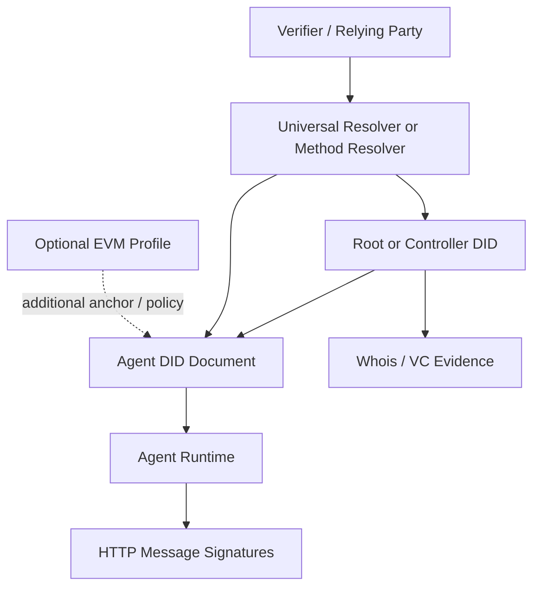

# RFC-001: Agent-DID (Unified Specification)

## Document Status

- **Status:** Release candidate (normative text for the `1.0.0` release contract)
- **Version:** 1.0-rc.4
- **Date:** 2026-11-04
- **Scope:** This RFC is the canonical core specification for Agent-DID as an application pattern on top of `did:webvh`, including the data model, composition semantics, runtime authentication profile, and SDK implementation guidelines.
- **Feedback:** Use the RFC feedback issue template or GitHub Discussions for errata, clarifications, and post-`1.0` proposals. Report vulnerabilities privately through [SECURITY.md](../SECURITY.md).

This revision (1.0-rc.4) supersedes `0.3-pivot-pattern-on-webvh`. It pins the external specifications Agent-DID builds on (§2.1), defines lifecycle authorization (§6.6), and requires that `did:webvh` logs be verifiable by any conforming resolver (§6.1). It is the text the `1.0.0` release will be held to; changes after `1.0.0` follow §11.2. The status does **not** imply W3C, DIF, IETF, or any other external standards-body approval of Agent-DID.

The key words "MUST", "MUST NOT", "REQUIRED", "SHOULD", "SHOULD NOT", "RECOMMENDED" and "MAY" are to be interpreted as described in BCP 14 ([RFC 2119] and [RFC 8174]) when, and only when, they appear in all capitals.

---

## 1. Summary

Agent-DID defines an application pattern on top of W3C DID documents for autonomous AI agents, with `did:webvh` as the recommended default DID method. Its goal is to allow any actor (human, organization, API, or agent) to reliably verify:

1. Who controls the agent.
2. What "brain" it runs (model/base prompt) without exposing sensitive IP.
3. What capabilities or certifications it declares.
4. Whether its identity is active, evolved, or revoked.
5. Whether runtime requests were signed by a key authorized for that agent identity.

The standard extends W3C DIDs/VCs with AI-specific metadata, defines an A2A identity composition contract that binds an agent to a human or organizational controller, and specifies a runtime authentication profile based on HTTP Message Signatures plus anti-replay controls. `did:webvh` is the normative reference method because it provides web-native discoverability and verifiable history; other DID methods MAY be supported as compatibility profiles when they preserve the same composition and verification semantics. EVM anchoring remains available as an optional deployment profile for environments that need additional on-chain immutability.

Agent-DID's conformance scope is deliberately limited to identity, controller/delegation semantics, and runtime signature authorization. A conforming implementation proves who had standing to make a call and whether the signing key was authorized for that action; it does **not** by itself prove that the agent's reasoning was correct or capture the full decision state that led to a call. Those concerns belong to a separate decision-provenance layer, such as signed execution receipts or trace attestations.

---

## 2. Relationship with Existing Standards

- **W3C DID / DID Document:** Foundation for decentralized identity.
- **`did:webvh`:** Recommended default method for agent identifiers, controller chains, and verifiable DID history.
- **W3C Verifiable Credentials (VC):** Support for compliance certifications.
- **`/whois` + organizational evidence (recommended pattern):** Publishes legal-entity and governance evidence that an agent verifier can recurse to.
- **HTTP Message Signatures / Web Bot Auth (emerging):** HTTP request signing for A2A/API authentication.
- **ERC-4337 / Account Abstraction (optional):** Additional deployment profile for autonomous account and economic operations.

Agent-DID does not replace these standards and does not define a new DID method. It composes them for the specific case of autonomous agents by standardizing AI-specific metadata, controller relationships, verification behavior, and runtime signing expectations.

### 2.1 Normative References

Where this RFC says an item is defined "by" one of these documents, that document governs. If this RFC and a reference disagree, the reference wins and the disagreement is an erratum of this RFC.

| Reference | Used for | Version |
| :--- | :--- | :--- |
| [did:webvh] | DID method, `did.jsonl` log format, SCID, `entryHash` chain, `updateKeys`, deactivation | **v1.0** (`method` parameter `did:webvh:1.0`) |
| [DID-CORE] | DID document data model and verification relationships | W3C Recommendation, DID Core v1.0 |
| [RFC 9421] | HTTP Message Signatures (signature base, `Signature-Input`, `Signature`) | RFC 9421 |
| [RFC 8941] | Structured Field Values, as used by `Signature-Input` and `Signature` | RFC 8941 |
| [RFC 9530] | `Content-Digest` header (`sha-256`) | RFC 9530 |
| [RFC 8785] | JSON Canonicalization Scheme (JCS) for hashing | RFC 8785 |
| [RFC 8032] | Ed25519 signatures | RFC 8032 |
| [RFC 2104] | HMAC, for salted commitments (§4.3) | RFC 2104 |
| [RFC 2119], [RFC 8174] | Requirement keywords | BCP 14 |

Informative: the IETF *web-bot-auth* drafts (HTTP signing for automated clients). Agent-DID separates itself from them with the `tag` parameter (§6.5).

**Evidence, not assertion.** Which of these references the reference SDKs are shown to satisfy, and by what external evidence, is recorded in [External-Conformance-Matrix.md](External-Conformance-Matrix.md). An implementation MUST NOT claim conformance with a referenced specification on the strength of this RFC alone.

---

## 3. Design Principles

1. **Persistent identity, mutable state:** The DID remains stable; the document can evolve.
2. **Method-aligned default:** `did:webvh` is the default and recommended DID method for normative examples and conformance guidance.
3. **Strong cryptography by default:** Ed25519 recommended for frequent signing.
4. **Composition over method invention:** Agent-DID adds application-layer semantics on top of existing DID methods rather than defining a new method.
5. **Deployment-profile flexibility:** Web-native deployment is the default; optional profiles such as EVM MAY add stronger anchoring where justified.
6. **Interoperability:** JSON-LD schema, method-aware resolution, and deterministic verification behavior across SDKs.

---

## 4. Agent-DID Document Structure

### 4.1 Base JSON-LD Schema

```json
{
  "@context": ["https://www.w3.org/ns/did/v1", "https://agent-did.org/v1"],
  "id": "did:webvh:example.com:agents:supportbot-x",
  "controller": "did:webvh:example.com:organizations:acme-support",
  "created": "2026-02-22T14:00:00Z",
  "updated": "2026-02-22T14:00:00Z",
  "agentMetadata": {
    "name": "SupportBot-X",
    "description": "Level 1 technical support agent",
    "version": "1.0.0",
    "coreModelHash": "hash://sha256/... or ipfs://...",
    "systemPromptHash": "hash://sha256/... or ipfs://...",
    "capabilities": ["read:kb", "write:ticket"],
    "memberOf": "did:fleet:0xCorporateSupportFleet"
  },
  "complianceCertifications": [
    {
      "type": "VerifiableCredential",
      "issuer": "did:webvh:trust.example:auditors:trustcorp",
      "credentialSubject": "did:webvh:example.com:agents:supportbot-x",
      "proofHash": "ipfs://Qm..."
    }
  ],
  "verificationMethod": [
    {
      "id": "did:webvh:example.com:agents:supportbot-x#key-1",
      "type": "Ed25519VerificationKey2020",
      "controller": "did:webvh:example.com:organizations:acme-support",
      "publicKeyMultibase": "z6Mk..."
    }
  ],
  "assertionMethod": ["did:webvh:example.com:agents:supportbot-x#key-1"],
  "authentication": ["did:webvh:example.com:agents:supportbot-x#key-1"]
}
```

#### 4.1.1 The `https://agent-did.org/v1` context

The context is defined by [`contexts/v1.jsonld`](../contexts/v1.jsonld) (decision: [ADR-003](ADR-003-JSON-LD-Context-and-agentMetadata.md)). It defines the Agent-DID terms (`agentMetadata` and its members, `complianceCertifications`, `blockchainAccountId`, `deactivated`) and the terms and types that the W3C DID v1 context lacks and that this RFC uses (`created`, `updated`, `publicKeyMultibase`, `Ed25519VerificationKey2020`, `Multikey`, `EcdsaSecp256k1RecoveryMethod2020`).

- A published context version is immutable. Its SHA-256 is pinned in `contexts/v1.jsonld.sha256`; a change to any term requires a new version at a new URL.
- Verifiers that process JSON-LD SHOULD use the pinned copy instead of fetching the URL. Agent-DID verification itself does not require JSON-LD processing: documents are hashed as JSON with JCS (§6.1), so an implementation conforms without a JSON-LD processor.
- Until `https://agent-did.org/v1` is served with the pinned bytes, the repository copy is the only normative source.
- `agentMetadata` is a property of the DID document. Representing it as a controller-issued Verifiable Credential is not part of 1.0.

### 4.2 Normative Field Definitions

| Field | Requirement | Description |
| :--- | :--- | :--- |
| `id` | **REQUIRED** | Unique agent DID. `did:webvh:...` is the recommended/default identifier form; other DID methods MAY be used if they preserve the composition and verification semantics in this RFC. |
| `controller` | **REQUIRED** | DID of the human, organizational, or higher-level agent controller. A resolvable `did:webvh` controller is RECOMMENDED for the canonical pattern. |
| `created` / `updated` | **REQUIRED** | ISO-8601 timestamps of the document. |
| `agentMetadata.coreModelHash` | **REQUIRED** | Commitment to the base model identifier (see §4.3) or another immutable URI such as `ipfs://`. |
| `agentMetadata.systemPromptHash` | **REQUIRED** | Commitment to the base prompt (see §4.3) or another immutable URI such as `ipfs://`. |
| `verificationMethod` | **REQUIRED** | Valid public keys for signature verification. |
| `verificationMethod[].deactivated` | OPTIONAL | ISO-8601 timestamp marking when a key was deactivated via rotation. Deactivated keys remain in the document; a signature by a deactivated key is checked against the key at the time the artifact states (Section 6.2.2), never accepted on the key's presence alone. |
| `assertionMethod` | **REQUIRED** for signing flows | References to keys authorized for payload and HTTP signature verification by default. |
| `authentication` | **REQUIRED** | References to valid authentication methods. |
| `complianceCertifications` | OPTIONAL | VC evidence and audits. |
| `agentMetadata.capabilities` | OPTIONAL | Declared/authorized capabilities. |
| `agentMetadata.memberOf` | OPTIONAL | Link to agent fleet/cohort. |

---

### 4.3 Metadata Commitments

`coreModelHash` and `systemPromptHash` let a verifier who is shown the value confirm it, without publishing the value itself. An unsalted digest does not achieve this for short or predictable values: anyone can hash candidate prompts or model names and compare.

Implementations SHOULD produce salted commitments:

- Format: `hash://hmac-sha256/<hex>`, where `<hex>` is the lowercase hexadecimal HMAC-SHA256 (RFC 2104) with the salt as key and the UTF-8 bytes of the value as message.
- The salt MUST be at least 32 bytes from a cryptographically secure random source, MUST be distinct per commitment, and MUST NOT be published in the DID document or its history.
- **Disclosure model:** the controller keeps each salt. To let an auditor or relying party verify a commitment, the controller discloses the value and its salt to that party out of band; the party recomputes the HMAC and compares it in constant time. Disclosing one salt reveals nothing about other commitments.

Verifiers MAY continue to accept the unsalted `hash://sha256/<hex(SHA-256(UTF-8(value)))>` form produced by earlier implementations, but MUST treat it as offering no confidentiality for guessable values.

## 5. Reference Architecture

### 5.1 Web-Native Reference Model



### 5.2 Mandatory Components

1. **Resolvable controller chain:** A verifier can resolve the agent DID and its controlling DID or equivalent authority chain.
2. **Agent DID document:** Includes `agentMetadata`, verification methods, and the DID verification relationships required for signing.
3. **Resolver path:** Universal resolver or method-native resolution that can obtain the current DID document and, where supported, verifiable history.
4. **Client SDK:** creation, signing, verification, rotation, revocation/deactivation handling, and composition-aware lifecycle operations.

### 5.3 Deployment Profiles

- **Default profile:** `did:webvh` over web-hosted DID history and documents, with controller recursion and VC-backed organizational evidence.
- **Compatibility profile:** Other DID methods such as `did:web`, `did:key`, or `did:ethr`, provided the verifier can still resolve the document and enforce the semantics of this RFC.
- **Optional EVM profile:** Additional anchoring, registry, or smart-account behavior for environments that require on-chain immutability. Defined in `RFC-001-EVM-Profile.md`, maintained with its contract and adapters in [edisonduran/agent-did-evm](https://github.com/edisonduran/agent-did-evm).
- **Recommended production resolution profile:** Use method-appropriate HTTPS, IPFS, and/or JSON-RPC sources with multiple endpoints/gateways, TTL cache, resolution telemetry, and transient error failover.
- **HA operational guide:** see `docs/RFC-001-Resolver-HA-Runbook.md` for SLO, alerts, and resilience drills.

---

## 6. Normative Operational Flows

### 6.1 Registration

1. The controller generates the DID and agent keys.
2. A JSON-LD document is built with model/prompt hashes.
3. The DID document and, where applicable, its method-specific history are published so a verifier can resolve the agent and its controller chain.

**did:webvh verifiability (MUST).** For `did:webvh` identities, the documents and logs an implementation emits MUST be verifiable by any conforming did:webvh v1.0 resolver, with no Agent-DID-specific code. Concretely, the published `did.jsonl` MUST follow [did:webvh] v1.0 (SCID derivation, `versionId` and `entryHash` chain, `eddsa-jcs-2022` data-integrity proofs by a current `updateKey`, parameters including `method: "did:webvh:1.0"`), and the Agent-DID-specific content (`agentMetadata`, `complianceCertifications`) MUST be carried only inside the DID document state of the log entries. An implementation MUST NOT depend on a side channel, a private log extension, or an Agent-DID-only field to make its log verify. A resolver in this RFC's sense MUST verify the whole log as required by §8.1 item 2 before using any of its state.

**Document reference (`documentRef`).** When an implementation addresses a DID document by content hash, the reference MUST be computed as `hash://sha256/<hex>`, where `<hex>` is the lowercase hexadecimal SHA-256 digest of the UTF-8 bytes of the document's JSON Canonicalization Scheme (JCS, RFC 8785) serialization. Values, including timestamps, MUST be hashed exactly as they appear in the document; implementations MUST NOT normalize them before canonicalization.

### 6.2 Resolution and Verification

1. Consumer obtains `Signature-Agent` or the issuer's DID.
2. Resolves DID via universal resolver (with fallback/failover in production profile). When the document is located through a registry `documentRef`, the resolver MUST verify that the retrieved document's `id` equals the requested DID and, for `hash://sha256/` references, that the document hashes to the reference as defined in §6.1. A document that fails either check MUST be rejected, and the resolver MUST NOT fall back to another source; fallback and failover apply only to availability failures (source unreachable, document not found). References whose scheme cannot be verified MUST be rejected unless the deployment explicitly accepts that scheme as unverified.
3. Verifies the signing key is authorized for the required DID verification relationship.
4. Verifies signature with `verificationMethod`.
5. Verifies the DID is currently active according to the underlying DID method or declared deployment profile.

#### 6.2.1 Verification Relationship Binding

Signature verification is not complete when the public key is merely present in `verificationMethod`. A verifier MUST confirm that the key ID is also listed in the DID verification relationship required by the action being verified.

The default signing purpose for Agent-DID payloads and HTTP signatures is `assertionMethod`. Other signing flows require `authentication`, `capabilityDelegation`, or `capabilityInvocation` as fixed per artifact kind in §6.2.1.3. A key listed only under `keyAgreement` MUST NOT be accepted for signing or proof verification.

When a key exists in the DID document but is not authorized for the requested purpose, SDKs MUST raise or surface a deterministic `key_purpose_violation` reason and, where practical, include the relationships where the key was found.

#### 6.2.1.1 Identity Composition Error Shape

To enable cross-implementation interop and programmatic verifiers, conforming SDKs MUST expose identity-composition errors with the following normative shape:

- `reason` (REQUIRED): one of the deterministic identity-composition reasons: `key_purpose_violation`, `rotation_window_closed`, `emergency_revoked`, `tampered`.
- `keyId` / `key_id` (REQUIRED): verification method identifier that triggered the failure (empty string when not applicable).
- `requiredPurpose` / `required_purpose` (REQUIRED): DID verification relationship the action required.
- `foundIn` / `found_in` (REQUIRED): verification relationships where the key was actually listed (MAY be empty).
- `did` (OPTIONAL): subject DID, included when known.

These fields MUST be exposed as direct properties of the error object using the language-idiomatic naming above. Implementations MAY additionally mirror the same fields under a `context` namespace (for example `error.context.keyId`) to interoperate with verifiers that expect a nested error envelope, provided the direct properties remain authoritative. Mirrored values MUST be byte-equal to the direct properties.

The `assertKeyPurpose` helper is a membership-only predicate over the requested verification relationship and MUST NOT short-circuit on `keyAgreement`. The signing-purpose policy that rejects `keyAgreement` for signing flows lives in `assertSigningPurpose` (or the equivalent entry point) and is invoked by the SDK before `assertKeyPurpose` during signature verification.

#### 6.2.1.2 Scope Boundary: Identity vs Decision Provenance

Successful RFC-001 verification proves that the caller identity, controller chain, key authorization, and active-state checks succeeded for the evaluated action. It MUST NOT be interpreted as proof that the underlying planner state, intermediate reasoning, or final decision quality were correct.

Implementations MAY pair Agent-DID verification with a separate signed execution receipt or trace attestation layer. A decision-provenance layer MAY include artifacts such as the tool name, canonicalized input hash, model/prompt/policy version references, trace or span identifiers, timestamps/nonces, and hashes of retrieved context or prior tool outputs.

Raw chain-of-thought capture is out of scope for RFC-001. Implementations that need stronger replayability or compliance evidence SHOULD prefer stable, minimal execution receipts over mandatory disclosure of full internal reasoning text.

#### 6.2.1.3 Required Relationship per Artifact Kind

The verification relationship of §6.2.1 depends on what the signature is for, not on who verifies it. A verifier MUST require the relationship in this table for each kind of signed artifact:

| Artifact kind | What it covers | Required relationship |
|---|---|---|
| `assertion` | Signed payloads, receipts, attestations, credentials and other claims made by the DID subject | `assertionMethod` |
| `http_request` | HTTP message signatures (§6.5) | `assertionMethod` |
| `delegation` | Issuing a delegation of authority to another party (for example a capability or an APS `AuthorityDelegationV1`) | `capabilityDelegation` |
| `invocation` | Exercising a capability that was delegated to the DID subject | `capabilityInvocation` |
| `authentication` | Proving control of the DID, for example in a challenge-response | `authentication` |

A key listed under one relationship MUST NOT be accepted for an artifact kind that requires another, even when the signature itself is valid. In particular, a key listed only under `assertionMethod` MUST NOT be accepted for issuing a delegation, and a key listed only under `capabilityDelegation` MUST NOT be accepted for an assertion. The rejection reason is `key_purpose_violation` with `requiredPurpose` set to the relationship in the table (§6.2.1.1). `keyAgreement` never appears in the table and never signs.

A protocol that defines a signed artifact not listed here MUST state which of these kinds it is before an Agent-DID verifier accepts it. Conforming SDKs MUST expose this table as one public constant (`REQUIRED_RELATIONSHIP_BY_ARTIFACT` with the lookup `requiredRelationshipFor` / `required_relationship_for`) and MUST use it wherever they choose a default relationship. The shared vectors are in `fixtures/verification-relationship-vectors.json`.

Documents created by the reference SDKs list the agent key under `authentication` and `assertionMethod`. A DID that issues delegations or invokes capabilities needs its key listed under `capabilityDelegation` or `capabilityInvocation`, otherwise verifiers following this section reject those artifacts. The SDKs add those relationships only on request (`additionalVerificationRelationships` / `additional_verification_relationships` at creation, accepting `capabilityDelegation` and `capabilityInvocation`); without it the document is the same as in earlier releases. When the agent key is rotated, the new key joins each of those relationships that listed a key the rotation deactivates.

#### 6.2.2 Key Validity at a Stated Time

A signed artifact can state when it was signed (for example `issued_at` in a delegation). That time is asserted by the signer: whoever holds a key, including a key that was later retired or compromised, can state any earlier time. A verifier that checks a signature against the DID state at a stated time MUST therefore evaluate it as follows, using a verified did:webvh log (§8.1 item 2):

1. The state at the stated time is the last log entry whose `versionTime` is not after it. If there is none, the key is **not authorized** (`did_not_yet_created`). If that entry deactivates the DID, the key is **not authorized** (`did_deactivated`).
2. In that state the key MUST exist with a public key (`key_not_found`), MUST NOT carry a `deactivated` time at or before the stated time (`key_deactivated`), and MUST be listed under the relationship §6.2.1.3 requires (`key_purpose_violation`). Otherwise it is **not authorized**. A stated time that is not an RFC 3339 date-time is **not authorized** (`invalid_stated_time`).
3. If a later change ends the key's authorization (a later entry removes the key, deactivates it, takes it out of the required relationship, or deactivates the DID, or the key's own `deactivated` time is after the stated time), the result is **indeterminate** (`key_retired_after_stated_time` or `did_deactivated_after_stated_time`), unless the verifier holds trusted time evidence that the signature existed before that change (for example an RFC 3161 timestamp it has verified). With such evidence earlier than the change, the key is **authorized**.
4. Otherwise the key is **authorized**.

A verifier MUST NOT accept an indeterminate result as authorized, and MUST NOT treat the stated time, a log `versionTime` or a document `created`/`updated` value as trusted time evidence. When no verified log is available for the DID, the result is indeterminate (`history_unavailable`). Comparisons use millisecond precision; sub-millisecond digits are truncated.

Other delegation formats draw the same line for the same reason (for example the `KEY_AMBIGUOUS` outcome of APS `AuthorityDelegationV1`, draft-pidlisnyi-aps §3.4); this section does not claim conformance with them. Conforming SDKs expose the check as `checkDidWebvhKeyAtTime` / `check_did_webvh_key_at_time` and `verifySignatureAtTime` / `verify_signature_at_time`. The shared vectors are in `fixtures/key-at-time-vectors.json`.

### 6.3 Evolution

1. The DID remains stable.
2. `updated` and hashes change in the new document version.
3. A new DID document version or history entry is published according to the underlying DID method.
4. Evolution is a lifecycle operation and is subject to §6.6.

### 6.4 Revocation

1. The controller (or defined policy) marks the DID as revoked or deactivated according to the underlying DID method/profile. Revocation is a lifecycle operation and is subject to §6.6. For `did:webvh` it is a log entry with `deactivated: true`.
2. All subsequent verifications must fail for active authentication.
3. In the optional EVM deployment profile, the contract policy MAY additionally allow revocation by `owner` or DID-authorized delegate, with explicit ownership transfer.

### 6.5 HTTP Signing (RFC 9421)

Agents sign HTTP requests with RFC 9421 HTTP Message Signatures using the following profile:

1. The request MUST carry `Signature-Agent` (the agent's DID), `Date`, and `Content-Digest` (RFC 9530, `sha-256`). The `Content-Digest` value is exactly `sha-256=:<base64 of SHA-256(body)>:`: a verifier MUST reject a field with any other form, including a dictionary that adds further algorithms.
2. The signature MUST cover, in this order, `"@method" "@authority" "@path" "@query" "content-digest" "date" "signature-agent"`. Additional components MAY follow. A verifier MUST reject a signature whose covered components start with anything else (a missing, reordered or preceded component).
3. The signature parameters MUST include `created`, `expires`, `nonce`, `keyid`, `alg="ed25519"` and `tag="agent-did"`. `keyid` MUST be a verification method of the `Signature-Agent` DID.
4. The signature base MUST be built as defined in RFC 9421 §2.5. Verifiers MUST rebuild it from the received request, with the `"@signature-params"` line re-serialized from the parsed `Signature-Input`.
5. Verifiers MUST reject the signature unless: the profile in items 2 and 3 is present; `created` is within the allowed clock skew; `now <= expires`; `Content-Digest` matches the body; and the signature verifies with an active key listed under `assertionMethod` in the resolved DID document.
6. Verifiers MUST record each accepted `(keyid, nonce)` pair until `expires` and reject a request that repeats one. The pair MUST be recorded only after the signature has verified.

### 6.6 Lifecycle Authorization

Update, key rotation and revocation (deactivation) change the identity that other parties rely on. They are authorized operations, not API calls.

1. **`did:webvh`.** Every lifecycle operation MUST be a new log entry carrying a data-integrity proof made by a key that is in the `updateKeys` parameter in force **before** that entry. An implementation MUST NOT append, and a verifier MUST reject, an entry whose proof is missing, invalid, or made by any other key. Changing `updateKeys` is itself such an operation.
2. **Signer supplied by the caller.** The implementation MUST obtain the signature from the controller's signer (an in-process key, KMS or HSM behind the signer abstraction). It MUST NOT sign lifecycle entries with a key derived from public data (the DID string, domain or SCID), and it MUST NOT accept a lifecycle request on the basis of the DID alone. Identities loaded from exported history carry no signer and MUST require one to be supplied per operation.
3. **Rotation.** Entries are verified against the keys in force at their position in the log. Keys removed from `updateKeys` MUST NOT authorize later entries. A verification method deactivated by rotation remains in the document (§4.2), but MUST NOT be accepted for new signatures; a signature by it is checked at the time the artifact states (§6.2.2).
4. **Revocation is final.** After a `deactivated: true` entry the DID MUST resolve as deactivated, no further entries are valid, and all subsequent verifications that depend on it MUST fail (§6.4). The log is authoritative: a registry or cache entry MUST NOT be used to reinstate a DID whose log is deactivated.
5. **Other DID methods.** Compatibility profiles MUST provide an equivalent: a lifecycle change is accepted only with proof of control by a key that the method designates as authorized for that change.
6. **Callers.** Whether a particular party may *ask* an implementation to perform a lifecycle operation is a deployment decision. The SDK enforces the cryptographic rule above; it does not replace access control around the signer.
7. **Controller chain.** An agent controlled by another DID (§4.2 `controller`) is operated through that controller's keys; the controller chain MUST be resolvable and active for the agent to verify (§6.2).
8. **Pre-rotation (optional).** A `did:webvh` DID MAY commit to the hashes of its next update keys (`nextKeyHashes`, did:webvh v1.0). While commitments are in force, an implementation MUST sign the next entry only with a key whose hash is committed and MUST set `updateKeys` in that entry to committed keys; a key that was active before can no longer authorize an entry, and verifiers MUST reject an entry that does not meet this. An implementation that offers pre-rotation MUST NOT accept a commitment to a key that is active in the same entry, and SHOULD advise keeping the private keys of committed keys apart from the active controller key (offline). Pre-rotation protects only if it is in force **before** a compromise: an attacker who holds the active key of a DID without commitments can start pre-rotation with their own keys.

The `tag` separates Agent-DID signatures from other RFC 9421 profiles such as the IETF *web-bot-auth* drafts. See [Anti-Replay-HTTP-Signatures.md](Anti-Replay-HTTP-Signatures.md) for guidance and a shared-store example.

---

## 7. SDK Implementation Guidelines (Reference)

The reference SDK (TypeScript/Python) must expose at minimum:

1. `create(params)`
2. `signMessage(payload, privateKey)`
3. `signHttpRequest(params)`
4. `resolve(did)`
5. `verifySignature(did, payload, signature)`
6. `revokeDid(did)`
7. `assertKeyPurpose(keyId, didDoc, requiredPurpose)` / `assert_key_purpose(...)`

### 7.1 Reference Contract/Registry (EVM)

The optional EVM deployment profile is defined in `RFC-001-EVM-Profile.md` in [edisonduran/agent-did-evm](https://github.com/edisonduran/agent-did-evm). It is not part of the minimum conformance floor for core RFC-001.

### 7.2 Interoperability Fixtures

Fixtures that Agent-DID generates itself prove consistency between the SDKs. They do not prove conformance with the references in §2.1; for that, see [External-Conformance-Matrix.md](External-Conformance-Matrix.md).

To validate verification compatibility between implementations, maintain versioned shared vectors (message and HTTP signatures) and run them in CI.

Current fixture reference:

- `fixtures/interop-vectors.json` (message and HTTP signatures: one valid request per DID method)
- `fixtures/http-verification-vectors.json` (the §6.5 verification rules: accepted requests and rejected requests, each rejected one differing from the valid request by a single change)
- `fixtures/canonical-document-reference.json` (`documentRef` computation)
- `fixtures/jcs-vectors.json` (RFC 8785 reference vectors)
- `sdk/tests/InteropVectors.test.ts`, `sdk/tests/HttpVerificationVectors.test.ts`, `sdk/tests/crypto.test.ts`, `sdk-python/tests/test_interop_vectors.py`, `sdk-python/tests/test_http_verification_vectors.py`

Conventions the shared vectors rely on, stated here so that an independent implementation does not have to infer them:

- A commitment salt carried as text is the lowercase hexadecimal encoding of its bytes (64 characters for the required 32 bytes); the HMAC key is the decoded bytes (§4.3).
- `signMessage` signs the UTF-8 bytes of the payload, and signatures are carried as lowercase hexadecimal.
- A verifier returns a rejection, never an exception, for a request whose `keyid` is not an `assertionMethod` key of the `Signature-Agent` DID document.

### 7.3 Quick Mapping: RFC → SDK

| RFC Flow | Reference SDK API/Artifact |
| :-- | :-- |
| Identity Registration (6.1) | `AgentIdentity.create(params)` |
| Payload Signing (6.2) | `signMessage(payload, privateKey)` |
| HTTP Signing (6.5) | `signHttpRequest(params)` |
| DID Resolution (6.2) | `AgentIdentity.resolve(did)` |
| Signature Verification (6.2) | `AgentIdentity.verifySignature(...)` and `verifyHttpRequestSignature(...)` |
| Verification Relationship Binding (6.2.1) | `assertKeyPurpose(...)` / `assert_key_purpose(...)`, default `assertionMethod` |
| Key Validity at a Stated Time (6.2.2) | `AgentDidClient.verifySignatureAtTime(did, payload, signature, keyId, { statedTime })`, `checkDidWebvhKeyAtTime(log, ...)`. `verifyHistoricalSignature` is deprecated: it accepts a retired key without any time check |
| Document Evolution (6.3) | `updateDidDocument(did, patch)` |
| Key Rotation (8.2) | `rotateVerificationMethod(did)` — marks old keys as `deactivated` |
| Revocation (6.4) | `revokeDid(did)` |
| Production Resolver (5.3) | `useProductionResolverFromHttp(...)`, `useProductionResolverFromJsonRpc(...)` |
| Optional EVM Integration (5.3) | `@agentdid/evm` / `agent-did-evm` (`EvmAgentRegistry`), in `edisonduran/agent-did-evm` |

### 7.4 Minimum End-to-End Flow (Onboarding)

1. Create the agent identity with `create(params)`.
2. Sign a payload with `signMessage`.
3. Verify that payload with `verifySignature` using the issued DID.
4. Resolve the DID with `resolve` and validate active state.
5. Revoke with `revokeDid` and confirm that subsequent verification fails.

Executable examples:

- `sdk/examples/quickstart.js`
- `scripts/e2e-smoke.js` and `sdk-python/scripts/e2e_smoke.py` (`npm run smoke:e2e`)

The optional EVM profile examples are in `edisonduran/agent-did-evm`.

Recommended full validation command:

- `npm run conformance:rfc001`

### 7.5 Expected Errors and Behavior

- **DID not found:** resolution fails (`DID not found` or resolver equivalent).
- **DID revoked:** `resolve`/`verifySignature` must fail or return invalid.
- **Invalid signature/tampered payload:** verification returns `false`.
- **Wrong key purpose:** verification raises or surfaces `key_purpose_violation` with the relationships where the key was found.
- **Incompatible `Signature-Input`:** HTTP verification returns `false`.
- **Unresolvable DID document or history entry:** resolver attempts failover; if all fail, error.

---

## 8. Security and Privacy

1. **Do not publish prompts in plaintext:** use salted commitments (§4.3); unsalted hashes of short or predictable prompts can be reversed by guessing.
2. **Key rotation:** define rotation policy and `verificationMethod` update.
3. **Immediate revocation:** critical requirement for key compromise.
4. **Principle of least privilege:** explicit and bounded capabilities.
5. **Auditing:** maintain evidence of versions and state changes.
6. **Do not overclaim signature semantics:** a valid Agent-DID signature proves authorized caller identity, not reasoning correctness or policy soundness.
7. **Reasoning privacy by default:** full chain-of-thought or planner-state disclosure is out of scope; if decision provenance is needed, prefer bounded execution receipts and hashed references.

### 8.1 Security considerations by flow (informative)

The full STRIDE analysis is in [Threat-Model.md](Threat-Model.md). Implementers and verifiers SHOULD read it; the points below are the ones that most affect interoperable behavior.

1. **Authentication is not trust.** A valid signature proves control of a DID, not that the DID deserves access. Verifiers MUST authorize DIDs themselves.
2. **Verify the whole log.** A `did:webvh` log MUST be verified in full (SCID, `entryHash` chain, proofs, `updateKeys` authorization) before any of its state is used. An integrity failure MUST NOT fall back to another resolution source.
3. **Freshness is not authenticated.** A log host can serve an older valid prefix or withhold new entries. Verifiers SHOULD bound resolver cache lifetime; for emergency revocation, see the `max_emergency_propagation_window` in the A2A composition contract.
4. **Replay state is the verifier's.** Verifiers MUST record `(keyid, nonce)` until `expires` after the signature verifies, in a store shared by all verifier instances.
5. **Time is signer-asserted.** `created` and log `versionTime` are not trusted timestamps; do not infer "signed before compromise" from them alone. A key retired after the time an artifact states gives an indeterminate result unless trusted time evidence is available (§6.2.2).
6. **Controller key custody.** Compromise of the controller key allows an attacker to rotate or deactivate the identity. The only in-protocol recovery is pre-rotation (§6.6 item 8), and only if the DID committed to successor keys before the compromise; without it there is none. Protect the active key with an HSM or KMS and keep the committed keys offline.
7. **Commitment salts** are secrets of the controller; leaking one re-enables guessing of the committed value.

---

## 9. Reference Use Cases

1. Independent agents on social/economic platforms.
2. Corporate governance and audited compliance.
3. Massive agent fleets with individual identity.
4. Integration with Zero-Trust APIs via HTTP signing.
5. Agent-to-agent commerce with cryptographic non-repudiation.

---

## 10. Compliance and Conformance

An implementer is considered **RFC-001 conformant** if it:

1. Emits a document compatible with section 4.
2. Implements registration/resolution/verification/revocation flows (section 6).
3. Can demonstrate signature verification against a resolved DID, including DID verification relationship enforcement for the signing key.
4. Supports the Agent-DID application pattern on `did:webvh` or on another DID method that preserves the semantics of this RFC.
5. For `did:webvh`, emits logs that satisfy the verifiability MUST of §6.1 and enforces lifecycle authorization as in §6.6.
6. Implements the HTTP signing profile of §6.5 and, where it emits metadata commitments, §4.3.
7. Treats the EVM profile as optional unless the implementation explicitly claims conformance to `RFC-001-EVM-Profile`.

RFC-001 conformance establishes identity/delegation and runtime signature-verification behavior only. It does not, by itself, certify reasoning correctness, planner integrity, or full decision-context capture.

---

## 11. RFC Governance

- Major changes: new RFC version (e.g., RFC-002).
- Compatible minor changes: revision of this version (`1.0-rc.N`, then `1.0.x`).
- Any extension must preserve interoperability of the base schema.

### 11.1 Conformance Evaluation

The operational compliance evaluation is maintained in:

- `docs/RFC-001-Compliance-Checklist.md`

### 11.2 Errata and Post-1.0 Corrections

After `1.0.0`, corrections to this RFC must follow an explicit errata path:

1. File the proposed correction through GitHub Discussions or the RFC feedback issue template and link the affected section.
2. Maintainers classify the proposal as one of: editorial erratum, compatible clarification, or normative change.
3. Editorial errata and non-behavioral clarifications may be merged into this document and recorded in `docs/RFC-001-CHANGELOG.md` without requiring a major version bump.
4. Any accepted change that alters conformance obligations, DID document requiredness, verification semantics, or the signature-level public API compatibility contract must ship under a new release plan and, after `1.0.0`, a SemVer major release.
5. Every accepted erratum must update any affected conformance fixtures, implementation notes, or migration guidance in the same change set.

---

## 12. Operational Glossary

- **Controller:** human/organizational identity that governs the agent in the DID document.
- **Root DID:** higher-level DID, typically organizational or legal-entity bound, from which trust in the agent can be recursively established.
- **Owner (EVM profile):** EVM account with operational control of the DID registration in the optional contract profile.
- **Delegate (EVM profile):** account authorized by `owner` for revocation actions in the optional contract profile.
- **DocumentRef:** method-specific reference to the agent's DID document or history artifact.
- **Universal Resolver:** component that combines DID resolution, document retrieval, and cache/failover across one or more supported methods.

---

[RFC 2119]: https://www.rfc-editor.org/rfc/rfc2119
[RFC 8174]: https://www.rfc-editor.org/rfc/rfc8174
[RFC 8785]: https://www.rfc-editor.org/rfc/rfc8785
[RFC 8941]: https://www.rfc-editor.org/rfc/rfc8941
[RFC 9421]: https://www.rfc-editor.org/rfc/rfc9421
[RFC 9530]: https://www.rfc-editor.org/rfc/rfc9530
[RFC 8032]: https://www.rfc-editor.org/rfc/rfc8032
[RFC 2104]: https://www.rfc-editor.org/rfc/rfc2104
[did:webvh]: https://identity.foundation/didwebvh/v1.0/
[DID-CORE]: https://www.w3.org/TR/did-core/

**License:** MIT
**Canonical document:** `docs/RFC-001-Agent-DID-Specification.md`
